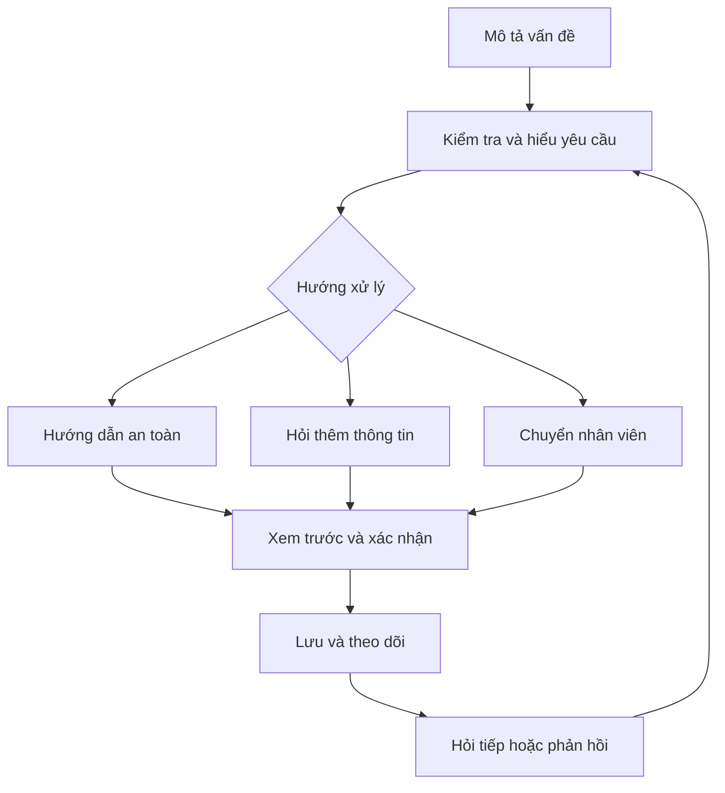
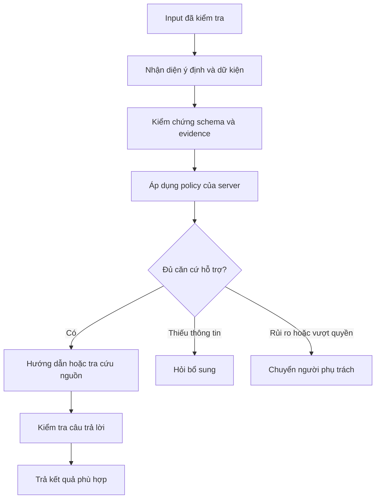

# VNG Support

Trợ lý hỗ trợ IT giúp người dùng mô tả vấn đề, nhận hướng dẫn an toàn, bổ sung thông tin và chuyển nhân viên hỗ trợ cùng lịch sử hội thoại.

**[Mở ứng dụng](https://vng-support.vercel.app)** · **[Gửi hỗ trợ](https://vng-support.vercel.app/guest)** · **[Hướng dẫn sử dụng](docs/USAGE.md)** · **[Vận hành](RUNBOOK.md)** · **[Kiến trúc](docs/ARCHITECTURE.md)**

Dự án thuộc **MLAI Hackathon 2026 — The Escalation Referee**. Phiên bản trình diễn dùng đăng nhập bằng ID và reviewer công khai để trải nghiệm nhanh. Policy và quyền là cơ chế mô phỏng của dự án, chưa phải quy định chính thức của VNG; app không tự thực thi thay đổi IAM, cloud hoặc database bên ngoài.

## Bắt đầu

| Vai trò | Thao tác |
| --- | --- |
| Người cần hỗ trợ | Chọn **Đăng nhập không cần tài khoản** để dùng ngay; hoặc **Tôi cần hỗ trợ** để đăng nhập bằng ID đã cấp. |
| Nhân viên mới | Chọn **Nhân viên mới?**, gửi đơn cấp ID và lưu liên kết theo dõi riêng. |
| Nhân viên hỗ trợ | Chọn **Dành cho nhân viên → Yêu cầu cần xử lý** để xem hàng đợi và xử lý hồ sơ. |
| Người trình diễn | Chọn **Dành cho nhân viên → Kiểm thử** để chạy tình huống hoặc nhập câu hỏi mới. |

1. Mô tả vấn đề bằng lời hoặc chọn theo danh mục.
2. Xem lại nội dung đã hiểu, hướng dẫn hoặc câu hỏi bổ sung. Bản xem trước chưa tạo hồ sơ.
3. Xác nhận gửi để lưu yêu cầu, hỏi tiếp và phản hồi kết quả.
4. Giữ liên kết hoặc mã đầy đủ để theo dõi. Mã ngắn `HT-…` giúp nhân viên tìm hồ sơ.

## Chức năng

### Dành cho người gửi

- **Gửi linh hoạt:** mô tả tự do, chọn danh mục hoặc sử dụng không cần tài khoản.
- **Hướng dẫn theo tình huống:** máy tính, máy in, VPN, phần mềm và các vấn đề hỗ trợ thông thường.
- **Hỏi đáp có nguồn:** giải thích khái niệm và hướng dẫn dựa trên kho tri thức; hiển thị nguồn tham khảo khi có.
- **Làm rõ yêu cầu:** hỏi thông tin còn thiếu, phân biệt các thao tác dễ nhầm như restart và khôi phục cài đặt gốc.
- **Hội thoại tiếp nối:** hỏi thêm về một bước, báo đã giải quyết hoặc yêu cầu gặp nhân viên.
- **Theo dõi:** trạng thái dễ hiểu, tiến trình xử lý và lịch sử hướng dẫn được giữ khi chuyển hỗ trợ.
- **Trải nghiệm desktop/mobile:** điều hướng bàn phím, trạng thái chờ, giữ nội dung khi lỗi, URL/QR và hỗ trợ giảm chuyển động.

Màn hình người gửi tập trung vào vấn đề và bước tiếp theo. Sentiment, rule, evidence kỹ thuật, kiểm tra an toàn nội bộ, expected result và giải thích audit được trình bày trong không gian nhân viên hỗ trợ.

### Dành cho nhân viên hỗ trợ

- Hàng đợi có tìm kiếm, phân trang, bộ lọc trạng thái, nhóm tiếp nhận và mã nhân viên.
- Hồ sơ gồm nội dung gốc, dữ kiện, thông tin còn thiếu, lý do chuyển tiếp và hướng dẫn đã gửi.
- Phân tích cảm xúc khi tiếp nhận và trong phản hồi được lưu để tham khảo; hồ sơ cũ không có dữ liệu sẽ ghi rõ chưa lưu.
- Audit chi tiết ghi actor, thời gian, chuyển trạng thái, rule, evidence và phiên bản policy.
- Hỏi bổ sung, duyệt, từ chối, dừng hoặc ghi nhận hoàn tất trong giới hạn workflow; server kiểm tra version để tránh ghi đè giữa các tab.
- Gợi ý tri thức được đưa vào hàng chờ rà soát, không tự xuất bản thành nguồn trả lời.

### ID nhân viên và trình diễn

- Đăng nhập bằng ID đã cấp còn hiệu lực, không yêu cầu mật khẩu trong chế độ demo.
- Gửi và theo dõi đơn cấp ID; job/profile có phiên bản và phạm vi quyền cụ thể.
- IT được gán vai trò có thể duyệt đơn và xử lý trùng ID.
- Sổ quyền/quota DEMO-SANDBOX minh họa quy trình xin và duyệt quyền; không cấp tài nguyên thật.
- Verify hỗ trợ các bộ tình huống, input mới, đọc lại hồ sơ và đối chiếu audit. Kết quả mô phỏng được phân biệt với lời gọi AI thật.

## Workflow hỗ trợ

Các sơ đồ được tách theo mục đích, dùng nhãn ngắn để đọc rõ trên GitHub và màn hình nhỏ.



### AI và kiểm tra an toàn



Model hỗ trợ hiểu ngôn ngữ và soạn câu trả lời; **server quyết định policy, quyền và giới hạn an toàn**. Cảm xúc không cấp quyền, thay đổi ưu tiên hoặc tự xác nhận đã giải quyết. Khi AI không sẵn sàng, app chỉ dùng hướng dẫn dự phòng đã được duyệt cho tình huống đủ căn cứ; trường hợp còn lại hỏi rõ hoặc chuyển hỗ trợ.

Retrieval dùng BM25 và kho tri thức có nguồn/revision. Hướng dẫn server đã đủ đáp ứng câu hỏi được tái sử dụng để tránh lượt diễn đạt AI dư thừa. Cache câu trả lời hợp lệ gắn phiên bản; preview có hạn sử dụng. Không bỏ kiểm tra an toàn để giảm thời gian phản hồi.

## Chạy local

Yêu cầu Node.js **22.13+** và npm. Chạy tại thư mục gốc của repo:

```powershell
npm ci
Copy-Item .env.example .env.local
npm run dev
```

Chỉ sao chép file mẫu khi chưa có `.env.local`; không ghi đè cấu hình đang dùng. Mở `http://localhost:3000`. Mặc định mẫu dùng AI mock và bộ nhớ demo, không cần key thật.

| Cấu hình | Mục đích |
| --- | --- |
| `AI_PROVIDER`, `AI_MODEL` | Chọn mock hoặc OpenAI và model; mẫu model là `gpt-6-luna`. |
| `OPENAI_API_KEY` | Key riêng khi dùng OpenAI; chỉ lưu trong môi trường bảo mật. |
| `MONGODB_URI`, `MONGODB_DB` | Lưu hồ sơ Support, tri thức và dữ liệu ứng dụng. |
| `IDENTITY_MONGODB_URI`, `IDENTITY_MONGODB_DB` | Lưu identity; có thể dùng cùng cluster/database `vng_main` với collection riêng. Identity cần MongoDB hỗ trợ transaction. |
| `SUPPORT_ACCESS_MODE` | `public-demo` cho bản trình diễn reviewer công khai. |

Không commit `.env.local`, credentials hoặc dữ liệu người dùng. [Chi tiết cấu hình, bootstrap và bảo trì](RUNBOOK.md).

## Cấu trúc repo

| Thư mục | Nội dung |
| --- | --- |
| `src/app` | Trang Next.js và API routes. |
| `src/components` | Giao diện người gửi, hỗ trợ và identity. |
| `src/domain` | Kiểu dữ liệu, policy, validation, tri thức và quy tắc nghiệp vụ. |
| `src/services` | Tiếp nhận, hội thoại, review và identity. |
| `src/lib` | Model, MongoDB, retrieval, cache và các adapter. |
| `tests` | Unit, integration và kiểm thử giao diện desktop/mobile. |
| `scripts` | Kiểm tra, đo đạc và công cụ vận hành có opt-in. |
| `docs` | Tài liệu sử dụng, kiến trúc, dữ liệu và các quyết định còn áp dụng. |
| `mlai26_new/data` | Dataset và policy lịch sử để hồi quy; không phải ứng dụng thứ hai. |

```powershell
npm run check:docs
npm run lint
npm run typecheck
npm test
npm run build
```

Hướng dẫn E2E, dịch vụ thật, đối chiếu SHA triển khai và kiểm tra dependency nằm trong [RUNBOOK](RUNBOOK.md). Prompt bàn giao và báo cáo triển khai đã hết vai trò được giữ trong lịch sử Git.

## Phạm vi phiên bản hiện tại

Bản public được giữ mở để quay video và trình diễn nhanh. Đăng nhập bằng ID và reviewer công khai là lựa chọn cho demo, không xác minh danh tính như SSO. Handoff hiện được ghi nhận trong app; tích hợp thông báo, ITSM/IAM và xử lý tài nguyên thật cần cấu hình riêng trước khi dùng với dữ liệu doanh nghiệp.

[Hướng dẫn sử dụng](docs/USAGE.md) · [Bản đồ kiến trúc](docs/ARCHITECTURE.md) · [Riêng tư](docs/PRIVACY-INVENTORY.md) · [Tài liệu kỹ thuật](docs/README.md)
