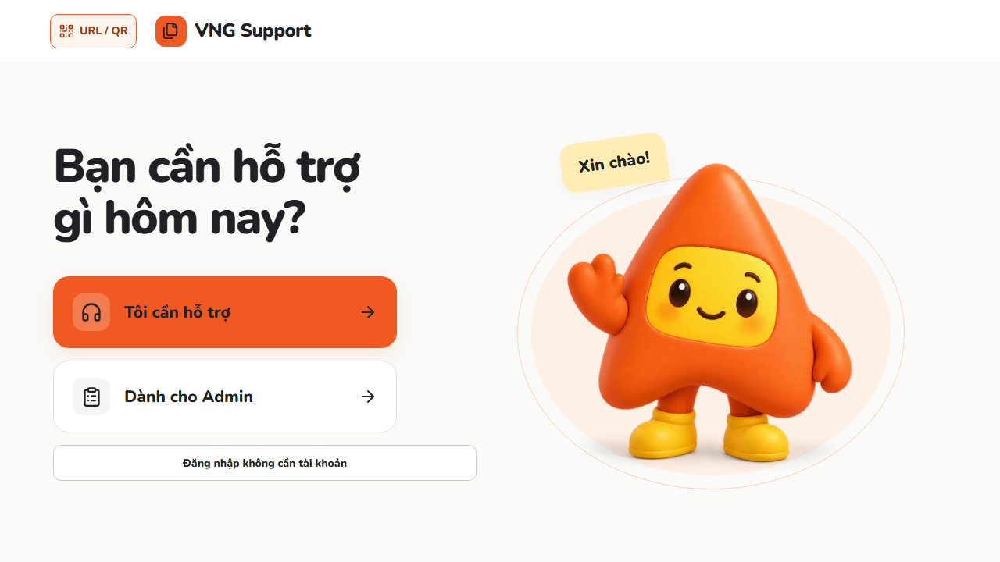
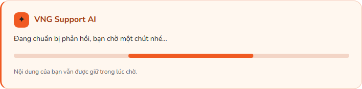
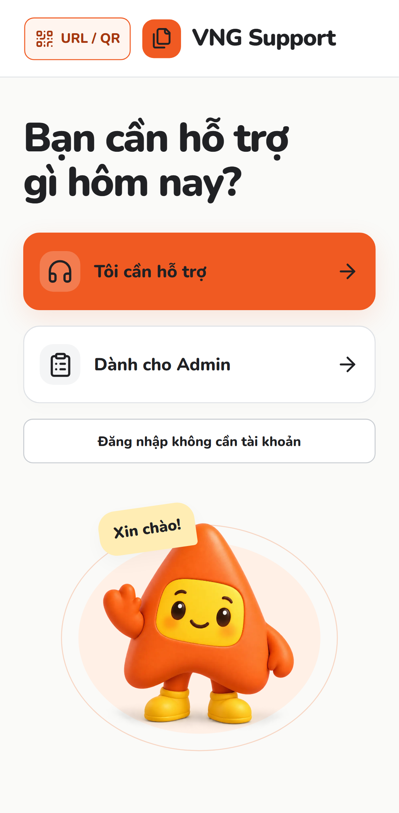
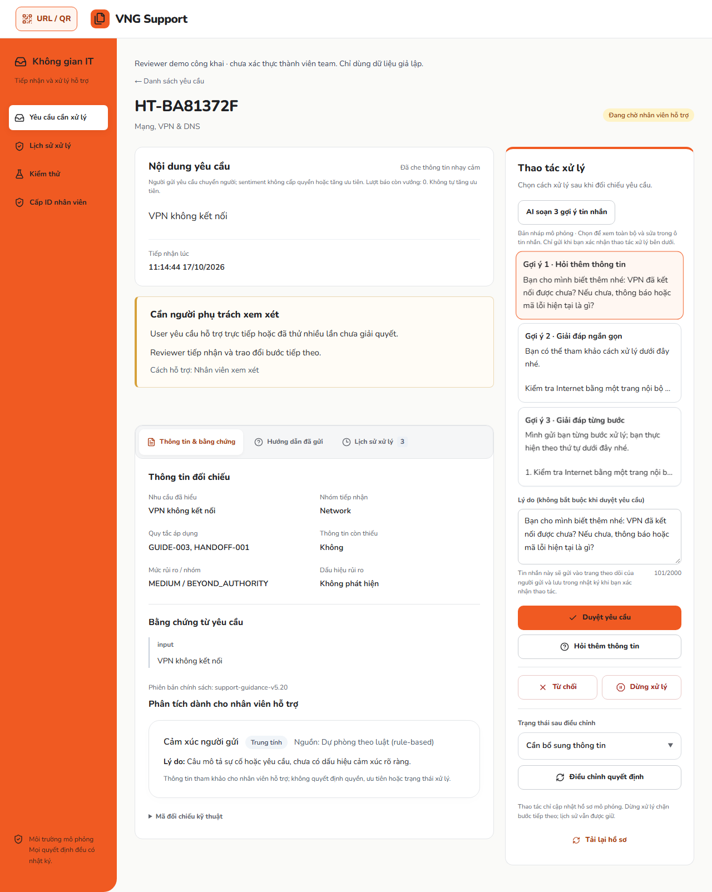
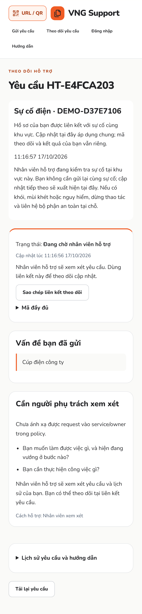
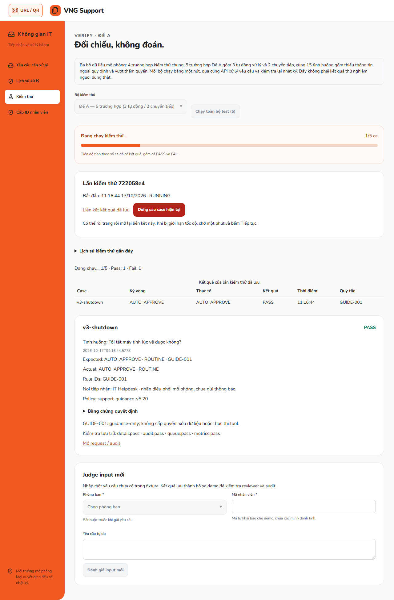
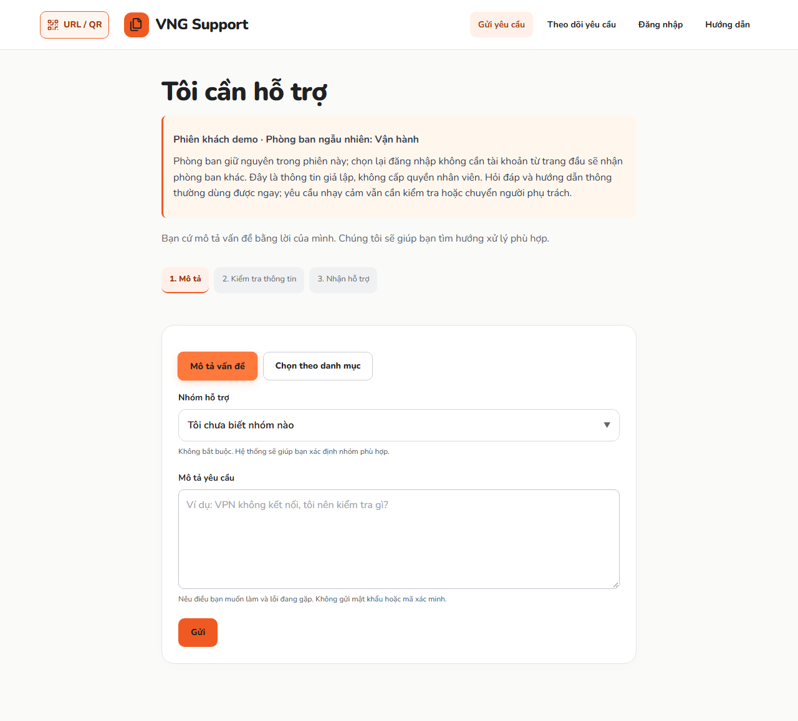

# VNG Support

Trợ lý hỗ trợ IT giúp người dùng mô tả vấn đề, nhận hướng dẫn an toàn, bổ sung thông tin và chuyển nhân viên hỗ trợ cùng lịch sử hội thoại.

**[Mở ứng dụng](https://vng-support.vercel.app)** · **[Gửi hỗ trợ](https://vng-support.vercel.app/guest)** · **[Hướng dẫn sử dụng](docs/USAGE.md)** · **[Vận hành](RUNBOOK.md)** · **[Kiến trúc](docs/ARCHITECTURE.md)**

Dự án thuộc **MLAI Hackathon 2026 — The Escalation Referee**. Phiên bản trình diễn dùng đăng nhập bằng ID và reviewer công khai để trải nghiệm nhanh. Policy và quyền là cơ chế mô phỏng của dự án, chưa phải quy định chính thức của VNG; app không tự thực thi thay đổi IAM, cloud hoặc database bên ngoài.

## Bắt đầu

| Vai trò | Thao tác |
| --- | --- |
| Người cần hỗ trợ | Chọn **Đăng nhập không cần tài khoản** để dùng ngay; hoặc **Tôi cần hỗ trợ** để đăng nhập bằng ID đã cấp. |
| Nhân viên mới | Chọn **Nhân viên mới?**, gửi đơn cấp ID và lưu liên kết theo dõi riêng. |
| Nhân viên hỗ trợ | Chọn **Dành cho Admin → Yêu cầu cần xử lý** để xem hàng đợi và xử lý hồ sơ. |
| Người trình diễn | Chọn **Dành cho Admin → Kiểm thử** để chạy tình huống hoặc nhập câu hỏi mới. |

1. Mô tả vấn đề bằng lời hoặc chọn theo danh mục.
2. Xem lại nội dung đã hiểu, hướng dẫn hoặc câu hỏi bổ sung. Bản xem trước chưa tạo hồ sơ.
3. Xác nhận gửi để lưu yêu cầu, hỏi tiếp và phản hồi kết quả.
4. Giữ liên kết hoặc mã đầy đủ để theo dõi. Mã ngắn `HT-…` giúp nhân viên tìm hồ sơ.

## Giao diện và chuyển động

Nút phản hồi khi hover/nhấn; ba lựa chọn trên trang đầu mở trang bằng hiệu ứng đường sáng từ giữa. Bấm logo **VNG Support** ở trang bất kỳ để về trang đầu qua hiệu ứng rèm cam. Skeleton shimmer xuất hiện trong lúc tải trang/dữ liệu; khung **VNG Support AI** có thanh chờ khi phân tích hoặc trả lời tiếp.

Thanh chờ không hiển thị phần trăm hay thời gian hoàn tất giả. Chuyển động dùng màu cam VNG `#F05A22`, giữ Nunito, hỗ trợ bàn phím/touch và `prefers-reduced-motion`; không trì hoãn lời gọi API để trình diễn hiệu ứng. Nếu mạng treo quá 60 giây, app báo chưa nhận được xác nhận và giữ nội dung để kiểm tra trạng thái hoặc thử lại.

Ảnh dưới chụp từ bản chạy local với dữ liệu giả lập và provider mock. Đây là minh họa giao diện, không phải bằng chứng inference AI thật hoặc phản hồi người dùng.

[](docs/images/motion-home-desktop.png)

| Khung chờ AI | Trang đầu trên điện thoại |
| --- | --- |
|  |  |

[Chi tiết hiệu ứng, nguồn tham khảo và kiểm thử](docs/UI-MOTION.md).

## Hỗ trợ hàng loạt và giám sát tự động

- **Admin → Đã xử lý tự động**: xem cả hồ sơ từng được auto-approve, kể cả đã hoàn tất hoặc đã chuyển người. Đối chiếu evidence, hướng dẫn và audit trước khi điều chỉnh theo guard hiện có.
- **AI soạn 3 gợi ý tin nhắn** trong chi tiết reviewer: **1 câu hỏi bổ sung + 2 phương án giải đáp** (ngắn gọn/từng bước), dựa trên đúng câu hỏi gốc và lịch sử đã che dữ liệu nhạy cảm. Model đang cấu hình (giữ Luna) soạn lời dẫn gần gũi “bạn/mình”; server giữ đầy đủ nội dung xử lý đã kiểm duyệt. Thiếu dữ kiện/quyền thì giải thích giới hạn và bước tiếp theo, không bịa đã khắc phục. Chọn và sửa bản nháp, rồi xác nhận thao tác xử lý để gửi. Tin nhắn được lưu cùng quyết định/audit, xuất hiện trong **Phản hồi của nhân viên** trên trang theo dõi và còn nguyên sau reload hoặc sự kiện mới. Lỗi AI dùng mẫu server, hiển thị đúng nguồn; chưa xác nhận thì chưa gửi.
- **Sự cố chung**: với mô tả ngắn như “Sự cố sập mạng” hoặc “Cúp điện công ty”, nhập cùng mã khu vực với đồng nghiệp. Cùng loại sự cố và khu vực được liên kết trong tối đa 24 giờ; thiếu khu vực thì giữ yêu cầu riêng. Admin cập nhật “đang kiểm tra / đang theo dõi / đã khắc phục” một lần cho cả nhóm; mỗi người nhận thông tin qua màn hình theo dõi, vẫn giữ mã và trạng thái riêng. Bỏ chọn “Gộp sự cố” để xem từng hồ sơ. Không có email/push notification.
- **FAQ cache 7 ngày**: câu VPN/Wi-Fi thông thường thuộc danh mục đóng có thể dùng lại mẫu server đã kiểm duyệt khi độ tương đồng từ vựng đạt 80%, template và policy vẫn khớp. Backend kiểm tra lại input, risk và policy; cache không chứa quyền, mật khẩu Wi-Fi hay dữ liệu cá nhân. Cache không áp dụng cho Verify, fault injection hoặc nội dung mở/nhạy cảm. Không phải mọi câu hỏi đều đủ điều kiện cache.
- **Sentiment**: ghi nhận cảm xúc tách khỏi quyết định. Lặp cùng câu bực bội không gọi AI hoặc tạo audit lặp; không tự tăng ưu tiên hay chuyển người chỉ vì nhãn negative. Nhu cầu hỗ trợ trực tiếp vẫn được tôn trọng. Số lần báo chưa xử lý được là tự báo cáo, không phải bằng chứng người gửi đã thực hiện thao tác; không gán nhãn người dùng “gian dối”.
- **Tiến độ Verify**: thanh cam VNG chuyển động theo số ca thực sự đã có kết quả, gồm cả PASS/FAIL. Lúc khởi tạo/đọc lại server, hiển thị đang chờ thay vì phần trăm giả. Hỗ trợ giảm chuyển động, giữ kết quả khi lỗi và tiếp tục lượt chạy.

Ảnh minh họa tính năng mới từ E2E local, provider mock, hồ sơ giả lập:

| Gợi ý tin nhắn cho reviewer | Cập nhật sự cố chung trên hồ sơ riêng |
| --- | --- |
|  |  |





[Hợp đồng và giới hạn](docs/BATCH-SUPPORT-CONTRACT.md) · [Báo cáo kiểm thử](docs/BATCH-SUPPORT-VALIDATION.md).

## ID demo

Có **41 ID đang hoạt động**: 1 tài khoản IT và 40 tài khoản nhân viên bên dưới. Tất cả tên, vị trí và đích tài nguyên trong bộ này là **dữ liệu giả lập**, không phải danh sách nhân sự VNG.

**Đăng nhập:** mở [Đăng nhập](https://vng-support.vercel.app/login), nhập ID rồi bấm **Đăng nhập**; bản demo không yêu cầu mật khẩu hoặc OTP. IT mở màn hình cấp ID; tài khoản nhân viên mở màn hình gửi hỗ trợ và tự điền ID từ phiên.

### Tài khoản IT

| ID | Vai trò | Màn hình sau khi đăng nhập |
| --- | --- | --- |
| `itnvgl` | IT — quản lý cấp ID (`identity-admin`) | Cấp ID nhân viên (`/identity/review`) |

### 40 tài khoản nhân viên

Manifest hiện phân bố trên **6 phòng ban**, giữ các scope khác nhau: 29 scope routine, 9 cần thẩm quyền, 2 thuộc bảo mật. Phòng ban không tự cấp quyền. Trường phòng ban mới cần [migration Mongo tường minh](RUNBOOK.md#bổ-sung-phòng-ban-cho-40-id-hiện-có); chưa coi dữ liệu Production đã cập nhật chỉ vì Git được push.

**Phiên khách:** chọn “Đăng nhập không cần tài khoản” sẽ nhận ngẫu nhiên một phòng ban giả lập và thấy ngay tên phòng ban trên form; không có ô chọn phòng ban/ID. Tải lại hoặc gửi tiếp trong cùng tab giữ phòng ban; chọn lại nút đăng nhập khách ở trang đầu sẽ nhận phòng ban khác. Nếu trình duyệt chặn sessionStorage, thông tin chỉ giữ trong bộ nhớ trang và có thể đổi sau reload. Phòng ban demo được lưu cùng từng yêu cầu, không phải danh tính đã xác minh hoặc quyền nhân viên.

Tên gồm **24 tên 3 chữ, 12 tên 4 chữ và 4 tên 5 chữ**. ID được tạo bằng tên cuối không dấu + chữ cái đầu của các phần đứng trước. Danh sách dưới đây thay thế 40 ID cũ; dùng ID mới để đăng nhập.

Bộ ID và scope đã được kiểm tra trên Production ngày 15/10/2026 (bằng chứng lịch sử, không phải kiểm chứng thay đổi phòng ban mới): đăng nhập, phiên, phạm vi job, chặn đích/môi trường khác, chặn quyền quản lý ID và đăng xuất.

| ID | Họ tên giả lập | Vị trí công việc | Phòng ban | Môi trường | Phạm vi job |
| --- | --- | --- | --- | --- | --- |
| `binhpt` | Phạm Thiên Bình | Kỹ sư Frontend | Kỹ thuật | Sandbox | Sửa repository · `demo/binhpt` |
| `tuanna` | Nguyễn Anh Tuấn | Kỹ sư Backend | Kỹ thuật | Staging | Đọc repository · `demo/tuanna` |
| `khangtd` | Trần Đức Khang | Kỹ sư DevOps | Kỹ thuật | Sandbox | Tạo cloud · `demo/khangtd` |
| `namlh` | Lê Hải Nam | Kỹ sư độ tin cậy SRE | IT | Production | Đọc log · `demo/namlh` |
| `anvm` | Võ Minh An | Chuyên viên kiểm thử thủ công | Kỹ thuật | Staging | Sửa task / dự án · `demo/anvm` |
| `longdb` | Đặng Bảo Long | Kỹ sư kiểm thử tự động | Kỹ thuật | Sandbox | Sửa repository · `demo/longdb` |
| `phucbt` | Bùi Thiên Phúc | Kỹ sư dữ liệu | Kỹ thuật | Staging | Đọc database · `demo/phucbt` |
| `tridm` | Đỗ Minh Trí | Quản trị cơ sở dữ liệu | IT | Production | Sửa database · `demo/tridm` |
| `linhhn` | Hồ Ngọc Linh | Thiết kế UI UX | Sản phẩm | Sandbox | Sửa task / dự án · `demo/linhhn` |
| `anhnm` | Ngô Mai Anh | Product Owner | Sản phẩm | Staging | Tạo task / dự án · `demo/anhnm` |
| `chaudb` | Dương Bảo Châu | Chuyên viên phân tích nghiệp vụ | Sản phẩm | Sandbox | Đọc task / dự án · `demo/chaudb` |
| `ngocvm` | Vũ Minh Ngọc | Chuyên viên phân tích bảo mật | IT | Production | Đọc log · `demo/ngocvm` |
| `vypk` | Phan Khánh Vy | Nhân viên hỗ trợ IT | IT | Sandbox | Đọc cấu hình · `demo/vypk` |
| `huymb` | Mai Bảo Huy | Trưởng nhóm Helpdesk | IT | Staging | Sửa task / dự án · `demo/huymb` |
| `quancn` | Cao Nhật Quân | Kỹ sư mạng | IT | Sandbox | Sửa cấu hình · `demo/quancn` |
| `datlm` | Lý Minh Đạt | Quản trị cấu hình mạng | IT | Production | Điều chỉnh cấu hình · `demo/datlm` |
| `baotg` | Tạ Gia Bảo | Kỹ sư Android | Kỹ thuật | Staging | Sửa repository · `demo/baotg` |
| `thaodp` | Đinh Phương Thảo | Kỹ sư iOS | Kỹ thuật | Sandbox | Sửa repository · `demo/thaodp` |
| `tamcm` | Chu Minh Tâm | Kỹ sư ứng dụng web | Kỹ thuật | Staging | Đọc repository · `demo/tamcm` |
| `dungha` | Hà Anh Dũng | Điều phối phát hành | Vận hành | Production | Tạo repository · `demo/dungha` |
| `diepln` | Lâm Ngọc Diệp | Nhà khoa học dữ liệu | Kỹ thuật | Sandbox | Đọc database · `demo/diepln` |
| `sontt` | Tô Thanh Sơn | Kỹ sư Machine Learning | Kỹ thuật | Staging | Tạo cloud · `demo/sontt` |
| `nguyentk` | Trịnh Khánh Nguyên | Kỹ sư MLOps | Kỹ thuật | Sandbox | Sửa cloud · `demo/nguyentk` |
| `hanhnm` | Nguyễn Minh Hạnh | Chuyên viên rà soát AI | Sản phẩm | Production | Phê duyệt task / dự án · `demo/hanhnm` |
| `hantng` | Trần Ngọc Gia Hân | Chuyên viên tài liệu kỹ thuật | Sản phẩm | Staging | Sửa task / dự án · `demo/hantng` |
| `khoilam` | Lê Anh Minh Khôi | Kỹ sư tích hợp hệ thống | IT | Sandbox | Sửa repository · `demo/khoilam` |
| `nganpnb` | Phạm Ngọc Bảo Ngân | Chuyên viên phân tích vận hành | Vận hành | Staging | Đọc log · `demo/nganpnb` |
| `chauvnm` | Võ Ngọc Minh Châu | Chuyên viên phân tích tài chính | Tài chính | Production | Đọc database · `demo/chauvnm` |
| `uyendtp` | Đặng Thanh Phương Uyên | Chuyên viên hệ thống nhân sự | Nhân sự | Sandbox | Đọc task / dự án · `demo/uyendtp` |
| `vinhbdq` | Bùi Đức Quang Vinh | Điều phối tài sản IT | Vận hành | Staging | Tạo task / dự án · `demo/vinhbdq` |
| `hadnt` | Đỗ Ngọc Thanh Hà | Chuyên viên mua sắm thiết bị | Vận hành | Sandbox | Sửa task / dự án · `demo/hadnt` |
| `minhhmn` | Hồ Minh Nhật Minh | Điều phối sự cố | Vận hành | Production | Sửa task / dự án · `demo/minhhmn` |
| `lamndp` | Ngô Đức Phúc Lâm | Kỹ sư dữ liệu kiểm thử | Kỹ thuật | Staging | Tạo database · `demo/lamndp` |
| `quyendnt` | Dương Ngọc Tú Quyên | Chuyên viên kiểm thử accessibility | Sản phẩm | Sandbox | Đọc task / dự án · `demo/quyendnt` |
| `hieuvdm` | Vũ Đức Minh Hiếu | Kỹ sư kiểm thử hiệu năng | Kỹ thuật | Staging | Đọc log · `demo/hieuvdm` |
| `trucpht` | Phan Hoài Thanh Trúc | Chuyên viên tuân thủ | Vận hành | Staging | Đọc task / dự án · `demo/trucpht` |
| `thanhmthd` | Mai Trần Hoàng Đức Thành | Nhân viên sao lưu dữ liệu | IT | Sandbox | Xuất dữ liệu database · `demo/thanhmthd` |
| `nhungcnth` | Cao Nguyễn Thị Hồng Nhung | Chuyên viên quản lý secrets | IT | Staging | Đọc secrets · `demo/nhungcnth` |
| `kietltmq` | Lý Trần Minh Quang Kiệt | Chuyên viên quản lý khóa mã hóa | IT | Sandbox | Luân chuyển khóa mã hóa · `demo/kietltmq` |
| `trangtlnd` | Tạ Lê Ngọc Diệu Trang | Chuyên viên kiểm toán hệ thống | Tài chính | Staging | Đọc log · `demo/trangtlnd` |

Mỗi ID có profile riêng và chỉ đúng đích `demo/<id>`. Phạm vi job vẫn phải qua policy: **29** trường hợp ít rủi ro được phép trong phạm vi; **9** trường hợp cần thẩm quyền riêng; **2** trường hợp secrets/khóa mã hóa bị chặn do rủi ro bảo mật. Nhãn môi trường Production dùng để thử chính sách; app không thực thi IAM, cloud hoặc database bên ngoài. Các tài khoản nhân viên không có role `identity-admin`.

[Manifest JSON của 40 ID](data/demo-identities.json) · [Hướng dẫn nhập có kiểm soát](RUNBOOK.md#bộ-40-id-demo). Người chưa có ID vẫn dùng được [chế độ khách](https://vng-support.vercel.app/guest).

## Chức năng

### Dành cho người gửi

- **Gửi linh hoạt:** mô tả tự do, chọn danh mục hoặc sử dụng không cần tài khoản.
- **Hướng dẫn theo tình huống:** máy tính, máy in, VPN, phần mềm và các vấn đề hỗ trợ thông thường.
- **Hỏi đáp có nguồn:** giải thích khái niệm và hướng dẫn dựa trên kho tri thức; hiển thị nguồn tham khảo khi có.
- **Làm rõ yêu cầu:** hỏi thông tin còn thiếu, phân biệt các thao tác dễ nhầm như restart và khôi phục cài đặt gốc.
- **Hội thoại tiếp nối:** hỏi thêm về một bước, báo đã giải quyết hoặc yêu cầu gặp nhân viên.
- **Theo dõi:** trạng thái dễ hiểu, tiến trình xử lý và lịch sử hướng dẫn được giữ khi chuyển hỗ trợ.
- **Trải nghiệm desktop/mobile:** điều hướng bàn phím, trạng thái chờ, giữ nội dung khi lỗi, URL/QR và hỗ trợ giảm chuyển động.

Màn hình người gửi tập trung vào vấn đề và bước tiếp theo. Sentiment, rule, evidence kỹ thuật, kiểm tra an toàn nội bộ, expected result và giải thích audit được trình bày trong không gian nhân viên hỗ trợ.

### Dành cho nhân viên hỗ trợ

- Hàng đợi có tìm kiếm, phân trang, bộ lọc trạng thái, nhóm tiếp nhận và mã nhân viên.
- Hồ sơ gồm nội dung gốc, dữ kiện, thông tin còn thiếu, lý do chuyển tiếp và hướng dẫn đã gửi.
- Phân tích cảm xúc khi tiếp nhận và trong phản hồi được lưu để tham khảo; hồ sơ cũ không có dữ liệu sẽ ghi rõ chưa lưu.
- Audit chi tiết ghi actor, thời gian, chuyển trạng thái, rule, evidence và phiên bản policy.
- Hỏi bổ sung, duyệt, từ chối, dừng hoặc ghi nhận hoàn tất trong giới hạn workflow; server kiểm tra version để tránh ghi đè giữa các tab.
- Gợi ý tri thức được đưa vào hàng chờ rà soát, không tự xuất bản thành nguồn trả lời.

### ID nhân viên và trình diễn

- Đăng nhập bằng ID đã cấp còn hiệu lực, không yêu cầu mật khẩu trong chế độ demo.
- Gửi và theo dõi đơn cấp ID; job/profile có phiên bản và phạm vi quyền cụ thể.
- IT được gán vai trò có thể duyệt đơn và xử lý trùng ID.
- Sổ quyền/quota DEMO-SANDBOX minh họa quy trình xin và duyệt quyền; không cấp tài nguyên thật.
- Verify hỗ trợ các bộ tình huống, input mới, đọc lại hồ sơ và đối chiếu audit. Kết quả mô phỏng được phân biệt với lời gọi AI thật.

## Workflow hỗ trợ

Các sơ đồ dưới đây được dựng từ Mermaid thành SVG để giữ đầy đủ dấu tiếng Việt và nhãn nhiều dòng trên GitHub. Bấm vào sơ đồ để mở bản đầy đủ; nguồn Mermaid được liên kết ngay bên dưới mỗi sơ đồ.

### 1. Tiếp nhận, xem trước và lưu yêu cầu

[](docs/diagrams/support-intake.svg)

[Nguồn Mermaid](docs/diagrams/support-intake.mmd). Xem trước chỉ lưu kết quả tạm có hạn dùng. Khi xác nhận, server đối chiếu fingerprint, thời hạn và phiên bản policy; preview không còn phù hợp phải được phân tích lại trước khi lưu ticket.

### 2. Hỏi tiếp, phản hồi và bàn giao nhân viên

[](docs/diagrams/support-followup.svg)

[Nguồn Mermaid](docs/diagrams/support-followup.mmd). Lượt hỏi mới vẫn đi qua kiểm tra policy. Giải thích một bước và phản hồi cảm xúc không tự xác nhận đã giải quyết. Nhân viên có thể hỏi bổ sung, duyệt, từ chối, dừng hoặc ghi nhận hoàn tất theo trạng thái được phép; duyệt yêu cầu không bắt buộc nhập lý do, các quyết định khác vẫn cần lý do và mọi thao tác phải đúng version. Nhánh Security risk không được approve/fulfill trong demo.

### 3. AI, bằng chứng và quyết định an toàn

[](docs/diagrams/ai-policy.svg)

[Nguồn Mermaid](docs/diagrams/ai-policy.mmd). Schema hoặc evidence sai không tạo ra phê duyệt. Dự phòng chỉ được dùng khi server tự xác định đủ căn cứ an toàn; không dùng fallback để vượt policy. [Workflow tạo câu trả lời, retrieval và cache](docs/ARCHITECTURE.md#câu-trả-lời-và-độ-trễ).

Model hỗ trợ hiểu ngôn ngữ và soạn câu trả lời; **server quyết định policy, quyền và giới hạn an toàn**. Cảm xúc không cấp quyền, thay đổi ưu tiên hoặc tự xác nhận đã giải quyết. Khi AI không sẵn sàng, app chỉ dùng hướng dẫn dự phòng đã được duyệt cho tình huống đủ căn cứ; trường hợp còn lại hỏi rõ hoặc chuyển hỗ trợ.

Retrieval dùng BM25 và kho tri thức có nguồn/revision. Hướng dẫn server đã đủ đáp ứng câu hỏi được tái sử dụng để tránh lượt diễn đạt AI dư thừa. Cache câu trả lời hợp lệ gắn phiên bản; preview có hạn sử dụng. Không bỏ kiểm tra an toàn để giảm thời gian phản hồi.

## Chạy local

Yêu cầu Node.js **22.13+** và npm. Chạy tại thư mục gốc của repo:

```powershell
npm ci
Copy-Item .env.example .env.local
npm run dev
```

Chỉ sao chép file mẫu khi chưa có `.env.local`; không ghi đè cấu hình đang dùng. Mở `http://localhost:3000`. Mặc định mẫu dùng AI mock và bộ nhớ demo, không cần key thật.

| Cấu hình | Mục đích |
| --- | --- |
| `AI_PROVIDER`, `AI_MODEL` | Chọn mock hoặc OpenAI và model; mẫu model là `gpt-6-luna`. |
| `OPENAI_API_KEY` | Key riêng khi dùng OpenAI; chỉ lưu trong môi trường bảo mật. |
| `MONGODB_URI`, `MONGODB_DB` | Lưu hồ sơ Support, tri thức và dữ liệu ứng dụng. |
| `IDENTITY_MONGODB_URI`, `IDENTITY_MONGODB_DB` | Lưu identity; có thể dùng cùng cluster/database `vng_main` với collection riêng. Identity cần MongoDB hỗ trợ transaction. |
| `SUPPORT_ACCESS_MODE` | `public-demo` cho bản trình diễn reviewer công khai. |

Không commit `.env.local`, credentials hoặc dữ liệu người dùng. [Chi tiết cấu hình, bootstrap và bảo trì](RUNBOOK.md).

## Cấu trúc repo

| Thư mục | Nội dung |
| --- | --- |
| `src/app` | Trang Next.js và API routes. |
| `src/components` | Giao diện người gửi, hỗ trợ và identity. |
| `src/domain` | Kiểu dữ liệu, policy, validation, tri thức và quy tắc nghiệp vụ. |
| `src/services` | Tiếp nhận, hội thoại, review và identity. |
| `src/lib` | Model, MongoDB, retrieval, cache và các adapter. |
| `tests` | Unit, integration và kiểm thử giao diện desktop/mobile. |
| `scripts` | Kiểm tra, đo đạc và công cụ vận hành có opt-in. |
| `docs` | Tài liệu sử dụng, kiến trúc, dữ liệu và các quyết định còn áp dụng. |
| `mlai26_new/data` | Dataset và policy lịch sử để hồi quy; không phải ứng dụng thứ hai. |

```powershell
npm run check:docs
npm run lint
npm run typecheck
npm test
npm run build
```

Hướng dẫn E2E, dịch vụ thật, đối chiếu SHA triển khai và kiểm tra dependency nằm trong [RUNBOOK](RUNBOOK.md). Prompt bàn giao và báo cáo triển khai đã hết vai trò được giữ trong lịch sử Git.

## Phạm vi phiên bản hiện tại

Bản public được giữ mở để quay video và trình diễn nhanh. Đăng nhập bằng ID và reviewer công khai là lựa chọn cho demo, không xác minh danh tính như SSO. Handoff hiện được ghi nhận trong app; tích hợp thông báo, ITSM/IAM và xử lý tài nguyên thật cần cấu hình riêng trước khi dùng với dữ liệu doanh nghiệp.

[Hướng dẫn sử dụng](docs/USAGE.md) · [Bản đồ kiến trúc](docs/ARCHITECTURE.md) · [Riêng tư](docs/PRIVACY-INVENTORY.md) · [Tài liệu kỹ thuật](docs/README.md)
