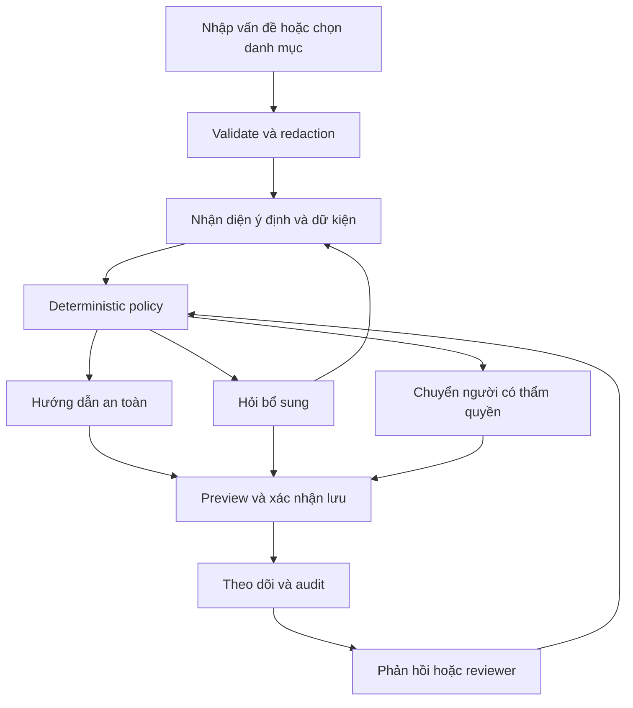
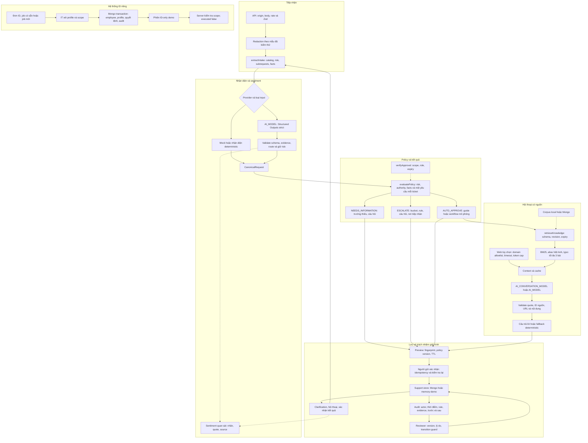

# VNG Support

**Trợ lý IT Helpdesk: hướng dẫn khi đủ căn cứ, hỏi thêm khi thiếu thông tin, chuyển người khi vượt thẩm quyền.**

Dự án sinh viên cho **MLAI Hackathon 2026 · Đề A — The Escalation Referee**. Policy mô phỏng phục vụ bối cảnh VNG Support, chưa phải chính sách chính thức của VNG. App không thực thi IAM, cloud hay database bên ngoài.

**[Mở ứng dụng](https://vng-support.vercel.app)** · **[Verify](https://vng-support.vercel.app/verify)** · **[Hướng dẫn](docs/USAGE.md)** · **[Vận hành](RUNBOOK.md)** · **[Tài liệu và bằng chứng](docs/README.md)**

Repo: [dakiemdarktharr/vng-support](https://github.com/dakiemdarktharr/vng-support). Chạy app từ thư mục gốc; `mlai26_new/` giữ tài liệu và dataset, không phải app thứ hai. Website có thể chạy phiên bản khác; kiểm tra `sourceRevision` trước khi đối chiếu kết quả.

## Bắt đầu trong một phút

| Bạn cần làm gì? | Đường đi |
| --- | --- |
| Gửi yêu cầu có tài khoản | **Tôi cần hỗ trợ → Đăng nhập** bằng ID đã cấp. |
| Gửi yêu cầu không tài khoản | **Đăng nhập không cần tài khoản** → mô tả vấn đề → xem trước → xác nhận gửi. |
| Xin ID | **Tôi cần hỗ trợ → Nhân viên mới?** → gửi đơn → giữ liên kết theo dõi → chờ IT. |
| Xử lý yêu cầu | **Dành cho nhân viên → Yêu cầu cần xử lý**; xem lý do, bằng chứng và lịch sử trước khi quyết định. |
| Chấm demo | **Dành cho nhân viên → Kiểm thử → Đề A → Chạy toàn bộ test (5)**. |

**Lưu ý Verify:** bộ `submission-4` giữ nhãn gốc nhưng case read-only thiếu IAM/ITSM proof nên hiện FAIL theo contract từ v5.14; không sửa Ground Truth để biến thành PASS.

**Demo cho giám khảo:** chạy Đề A → đối chiếu **3 routine / 2 escalation** → mở request/audit → nhập một tình huống mới. Có thể bỏ qua tour. Verify có ghi request; khi dùng OpenAI thật có thể phát sinh chi phí. [Hướng dẫn giám khảo](docs/JUDGE-ONBOARDING.md) · [Brief](Challenge_Brief_OrganizationAI_VN.docx.md).

Người gửi có thể viết câu kể, không cần biết thuật ngữ IT hay đặt thành câu hỏi. Preview chưa lưu ticket; sau xác nhận, giữ liên kết hoặc UUID đầy đủ để theo dõi. Mã `HT-…` dùng tìm trong reviewer/audit. Khách nhận hướng dẫn thông thường trong policy, không có quyền IT hay quyền đối với tài nguyên.

Các tính năng vẫn có: gửi tự do/theo danh mục, clarification, hội thoại và phản hồi kết quả, theo dõi, URL/QR, onboarding, reviewer, audit, Verify 4/5/15 ca và input mới, gợi ý tri thức chờ duyệt, cấp ID/job/scope. [Hướng dẫn đầy đủ](docs/USAGE.md).

## Bằng chứng hiện tại

**Bản sửa AI v5.18 (15/10/2026):** Structured Outputs strict, kiểm chứng quote,
phân biệt DNS khái niệm/VPN lỗi kết nối, giữ câu làm rõ reset và bàn giao từ
hội thoại. Khi AI không sẵn sàng, chỉ tác vụ an toàn được server xác định độc
lập mới dùng hướng dẫn đã kiểm duyệt; giao diện và audit ghi nguồn/lý do.
[Hợp đồng dự phòng và cách kiểm tra](docs/AI-RESILIENCE-2026-10-15.md).

Ca lịch sử `v3-model-offline` trong bộ `extended-v3` vẫn giữ kỳ vọng cũ và
ghi mismatch khi VPN đủ căn cứ nhận hướng dẫn dự phòng thay vì chuyển
người. Ca này không thuộc bộ 15 tình huống giám khảo. Không sửa nhãn gốc.
Health `modelConnectivity=NOT_CHECKED` vẫn chỉ là kiểm tra cấu hình;
bằng chứng inference phải được kiểm tra riêng.

Lượt **v5.17**, base main `8eb1f09`: giữ **89/128 exact-match (69,53%), 39
mismatch** trên fixture development mock/memory; không có regression mới.
Sửa dữ kiện bị bỏ sót ở 8 case, chuẩn hóa quyền read-only, câu trả lời thời hạn
ngắn và nhận diện thao tác phá hủy DB. Các blocker quyền/approval vẫn giữ;
không thay Ground Truth hoặc bổ sung bằng chứng giả để tăng điểm.
[Báo cáo mới và đối chiếu từng case](docs/MISMATCH-FOLLOWUP-2026-10-14.md).
**Không có bằng chứng đạt 9,5/10.**

Lịch sử [v5.16 và sổ quyền/quota demo](docs/AUTHORITY-REVIEW-2026-10-14.md):
hai role Jira được định nghĩa, TTL có xác nhận và owner chỉ DEMO-SANDBOX.

### Lịch sử v5.15

Rà soát mismatch **14/10/2026**, base main `fb76162` → commit code `d585d02` / policy v5.15. Đo lại 128 fixture development trên từng SHA, **local, mock/memory, không gọi API model**; giữ nguyên Ground Truth. [Báo cáo từng case và giới hạn](docs/MISMATCH-REVIEW-2026-10-14.md) · [Metadata máy đọc](docs/MISMATCH-REVIEW-2026-10-14.json). Đây không phải held-out hay accuracy tổng quát.

| Phép đo | Base → bản sửa | Ý nghĩa |
| --- | --- | --- |
| Development exact-match | 90/128 (70,31%) → 89/128 (69,53%) | Điểm giảm một ca; nhãn gốc vẫn giữ. |
| Ca kỳ vọng routine bị escalation | 18/34 → 8/34 | Sửa lỗi phủ định/tách ngữ cảnh; các ca vẫn thiếu facts/proof nên chưa AUTO. |
| Ca kỳ vọng escalation chuyển sang hỏi thêm | 1/94 → 2/94 | Hai ca GPU theo contract hỏi đủ facts trước quota unavailable; không có ca được auto-approve. |
| Coverage / readback | 128/128 → 128/128 | Readback bộ nhớ, chưa chứng minh Mongo restart. |

Đã rà soát 38 mismatch cũ; sau sửa còn **39**: 25 thiếu facts, 8 approval chưa xác minh, 1 yêu cầu nhiều tài nguyên, 3 bất đồng Security/Authority và 2 GPU. Regression 11 GPU giữ hỏi bổ sung theo quyết định chủ repo. Ca 24 GPU phát sinh exact-pass regression vì trước đó khớp nhãn nhờ lỗi tách câu; không phục hồi lỗi để tăng điểm. **900 unit/integration tests đạt**, thêm 35 regression synthetic; không suy ra readiness 9,5/10. Held-out độc lập, tác động thực tế, Mongo restart và model live chưa được kiểm chứng trong lượt này.

Lịch sử: [tích hợp main v5.14, sentiment/retrieval và dependency audit](docs/INTEGRATION-AUDIT-2026-10-14.md) · [base chốt b069f22](docs/REPO-AUDIT-2026-10-14.md). Các số lịch sử không được coi là phép đo mới.

## Workflow tổng quát



Policy **v5.18** (15/10/2026) là authority cuối: **risk → authority → missing information → routine**. Routine có quyền cần identity/entitlement đã xác minh; approval cần cùng record registry/ITSM, scope/role phù hợp; sandbox cần quota/capacity có nguồn đáng tin cậy. Khi thiếu facts và quota chưa xác minh, hỏi đủ facts trước khi kiểm tra quota; không suy ra vượt quota từ ngưỡng GPU demo cũ. Ticket nhiều yêu cầu được yêu cầu tách riêng sau kiểm tra risk/authority. Các resolver này chưa tích hợp với hệ thống VNG thật, nên chưa đủ bằng chứng thì fail-closed. Hướng dẫn thông thường vẫn dùng được trong demo. Sentiment chỉ quan sát cảm xúc; không cấp quyền, đóng ticket hay bỏ qua yêu cầu chuyển người. Kết quả `AUTO_APPROVE` không xác nhận hạ tầng đã được thay đổi.

## Workflow chi tiết theo module



Model ID lấy từ cấu hình `AI_MODEL` (mẫu hiện tại `gpt-6-luna`), không chứng minh tài khoản API có quyền dùng model đó. Mock không gọi API; lỗi model/provider quota/validation ghi rõ fallback. Retrieval dùng **BM25**, không có embedding/vector database. Preview có TTL 10 phút; dữ liệu lưu gắn policy version. Audit lưu căn cứ quyết định, không lưu chain-of-thought. [Chi tiết module và nhánh xử lý](docs/ARCHITECTURE.md) · [Retrieval](docs/RAG-RETRIEVAL.md) · [Sentiment](docs/SENTIMENT-EVALUATION.md).

## Đăng nhập, cấp ID và phạm vi quyền

### Thời hạn và quyền demo

Nếu yêu cầu quyền thông thường thiếu thời hạn, preview có thể đề xuất **đọc
8 giờ / ghi 4 giờ**, hoặc **VPN QA/dev 8 giờ** khi đã biết nguồn và đích.
Bấm **Dùng … giờ và kiểm tra lại**, rồi xem preview mới trước khi gửi. Không
tự điền thời hạn hoặc tự cấp/gia hạn quyền. Production, quyền nhạy cảm và
yêu cầu cloud không dùng mặc định này. Vai trò Jira Developer/standard agent
giới hạn thao tác theo ticket/hàng đợi được giao; tên role không chứng minh
entitlement.

Trong **Cấp ID nhân viên → Sổ quyền và quota DEMO-SANDBOX**, người đăng nhập
có thể xin quyền demo, theo dõi quyết định và kiểm tra quota. IT chỉ được
duyệt khi operator đã gán owner của project này; không tự duyệt đơn mình.
Sổ lưu bằng MongoDB identity, có version, idempotency và audit cùng giao dịch.
Không bootstrap tự động và chưa được khởi tạo trên Mongo thật trong lượt này.

Pool giả lập: **16 vCPU, 64 GB RAM, 500 GB disk, 4 GPU T4; tối đa 24 giờ**.
Kiểm tra cộng cả usage + giữ chỗ + yêu cầu mới; snapshot thiếu/hết hiệu lực
không coi usage bằng 0. **Ngân sách chưa cấu hình vẫn chuyển owner** dù còn
quota. Approval và entitlement demo không thay quyết định Support, không
được coi là IAM/ITSM thật và không cấp hạ tầng. Xem [contract 13 quyết định](docs/decisions/DEMO-AUTHORITY-CONTRACT.md)
và [hướng dẫn operator](RUNBOOK.md#sổ-quyền-và-quota-demo).

### Đăng nhập không mật khẩu

Màn hình `/login` chỉ yêu cầu ID. Theo yêu cầu demo, đã bỏ OTP cho cả người gửi và người xử lý ID. ID đã cấp và còn `ACTIVE` được đăng nhập; ID sai, chưa cấp hoặc bị vô hiệu hóa bị từ chối. Tài khoản có role `identity-admin` do operator cấp được đưa tới trang cấp ID; tài khoản thường tới form hỗ trợ. Tên job, level CSV hoặc header `X-Employee-ID` không cấp role này.

**Biết ID không chứng minh danh tính.** Mọi phiên có assurance `demo`; người biết ID IT có thể mạo danh và duyệt đơn. Chỉ dùng dữ liệu giả lập, không coi đây là xác thực production an toàn. Cookie HttpOnly/SameSite Strict hết hạn sau 8 giờ; server kiểm tra lại trạng thái ACTIVE, expiry và role mỗi request. API kiểm tra scope chỉ mô phỏng, luôn `executed: false` và không bỏ policy rủi ro.

OTP relay không còn là cấu hình bắt buộc; `/api/identity/verify` trả 410. Dữ liệu OTP/kênh cũ không bị xóa tự động, không được dùng để đăng nhập hoặc trả ra danh bạ. Hướng dẫn khởi tạo IT demo nằm trong [RUNBOOK](RUNBOOK.md#khởi-tạo-người-xử-lý-id).

[Báo cáo ID-only demo](docs/archive/IDENTITY-ID-ONLY-DEMO.md) ghi phạm vi thay đổi, kiểm thử local và bootstrap/readback Mongo thật; không thay thế kiểm chứng persistence qua restart.

### Nhân viên mới

1. Chọn **Nhân viên mới?**, nhập họ tên và chọn **job có sẵn** hoặc **Tạo job mới**. Form không thu thập liên hệ, mật khẩu hay bí mật.
2. Job có sẵn hiển thị phạm vi của đúng phiên bản profile; IT duyệt gắn nguyên profile đó. Job mới cần tên và các scope đề xuất; IT chỉ được duyệt tập con của scope đã gửi trước khi tạo profile.
3. Mỗi scope gồm **môi trường → tài nguyên → thao tác → đích cụ thể**. Ví dụ giả lập: sandbox → task/dự án → đọc → `project-demo/task-01`. Không nhận wildcard, “all” hoặc quyền tự do.
4. Xem lại rồi **Gửi đơn cho IT**. Chỉ có biên nhận sau khi MongoDB ghi thành công; nếu lỗi, giữ trang và thử lại cùng nội dung.
5. Lưu liên kết theo dõi riêng. Ai có liên kết có thể đọc đơn; không chia sẻ công khai. Token nằm trong fragment URL, không được app lưu vào localStorage; chưa có cơ chế khôi phục liên kết mất.

| Trạng thái | Ý nghĩa |
| --- | --- |
| `PENDING` | Chờ IT xác minh, chưa cấp ID. |
| `ID_CONFLICT` | ID bị trùng; IT cần xử lý, không ghi đè tài khoản. |
| `APPROVED` | Đã cấp ID; trang thành công hiển thị ID chính thức và nút đăng nhập. |
| `REJECTED` | Không cấp tài khoản; xem lý do và gửi đơn mới phù hợp. |

Helper [generateEmployeeId](src/domain/identity.ts) bỏ dấu, chuyển thường, lấy từ cuối rồi nối chữ đầu các từ trước: `Phạm Quang Minh Hòa → hoapqm`, `Trần Ngọc Anh → anhtn`. Đây là ví dụ công thức, không phải tài khoản có thể đăng nhập. Unique index MongoDB chặn trùng; sau khi xác nhận va chạm, IT chọn hậu tố số có lý do, không tự cấp trùng hay âm thầm ghi đè.

Danh mục gồm sandbox/staging/production; task/project, repository, log, database/schema, cloud, cấu hình, secrets, khóa và quản trị; các thao tác đọc/tạo/sửa/xóa/thực thi/phê duyệt/cấu hình/xuất dữ liệu/luân chuyển/thu hồi khóa. Server so khớp chính xác toàn bộ scope. Production, secrets, khóa, quản trị và thao tác rủi ro vẫn cần thẩm quyền riêng dù đã nằm trong job được duyệt. `POST /api/identity/access` kiểm tra và ghi audit, luôn trả `executed: false` vì chưa có connector thực thi.

## Chạy trên máy của bạn

Dùng **Node.js 22.13+** (CI dùng Node 24), npm và Git. Trong PowerShell:

```powershell
git clone https://github.com/dakiemdarktharr/vng-support.git
cd vng-support
npm ci
if (-not (Test-Path .env.local)) { Copy-Item .env.example .env.local }
npm run dev
```

Mở **http://localhost:3000**. Với checkout đã có, chạy từ thư mục gốc và giữ nguyên `.env.local` cá nhân. Trên macOS/Linux, có thể sao chép bằng `test -f .env.local || cp .env.example .env.local`.

Cấu hình mẫu chạy **Support/Verify bằng mock + memory-demo**, không cần API key. Dữ liệu bộ nhớ mất khi tiến trình dừng. Để thử ngay, dùng **Đăng nhập không cần tài khoản** hoặc **Dành cho nhân viên → Verify**. Đăng nhập/cấp ID cần MongoDB riêng, không chạy bằng CSV hoặc bộ nhớ tạm.

### Cấu hình theo chức năng

| Chức năng | Biến môi trường | Hành vi |
| --- | --- | --- |
| Demo hỗ trợ offline | `AI_PROVIDER=mock`, `SUPPORT_STORAGE=memory-demo`, `SUPPORT_ACCESS_MODE=public-demo` | Không gọi model thật; reviewer công khai chỉ phù hợp dữ liệu demo. |
| Lưu Support/Verify | `MONGODB_URI`, `MONGODB_DB` | Khi có URI, dùng MongoDB; lỗi kết nối không chuyển request sang bộ nhớ. Vercel production yêu cầu MongoDB. |
| Model thật | `AI_PROVIDER=openai`, `AI_MODEL`, `OPENAI_API_KEY` | Nhận diện/hỗ trợ qua API có chi phí; không suy ra đang bật trên website từ README. |
| Hội thoại và web | `AI_CONVERSATION_MODEL`, `AI_WEB_SEARCH`, `AI_WEB_MODEL` | Model hội thoại để trống dùng model chính; web mặc định tắt trong file mẫu. |
| Hạn mức gọi model | Không có hạn mức theo ngày ở cấp ứng dụng trong production | OpenAI vẫn áp dụng rate limit/quota tài khoản và mỗi inference có thể tính phí; bộ test dùng `AI_TEST_MAX_ATTEMPTS` làm guard; API intake demo giới hạn 30 request/phút/client. |
| Giả lập lỗi Verify | `SUPPORT_VERIFY_FAULTS` | Dành cho kiểm thử/demo theo guard hiện có; không phải lỗi model thật. |

Không đưa API key, URI thật hay `.env.local` vào Git. Xem [file cấu hình mẫu](.env.example) và [runbook](RUNBOOK.md) trước khi bật dịch vụ thật.

### MongoDB cho hệ thống ID

Hệ thống ID chỉ dùng MongoDB cho nhân viên, profile/version, đơn, quyết định, audit và phiên. Cần **replica set hoặc cluster hỗ trợ transaction**; standalone không đủ.

- `IDENTITY_MONGODB_URI`: URI riêng hoặc để trống để dùng `MONGODB_URI`.
- `IDENTITY_MONGODB_DB`: **bắt buộc chỉ định database riêng** cho identity; không tự dùng tên database Support.

Các biến identity có mẫu trong `.env.example`; URI để trống. Tên database
riêng được chủ repo chọn là `vng_support_identity`. Trên hosting phải cấu hình
`IDENTITY_MONGODB_DB` cho đúng môi trường; file mẫu không tự cấu hình Vercel.
URI identity để trống dùng `MONGODB_URI` hiện có. Xem [cấu hình và bootstrap IT](RUNBOOK.md#hệ-thống-id-nhân-viên).
Database mới không có tài khoản/profile seed tự động. Operator khởi tạo người xử lý
qua `scripts/identity-bootstrap.mjs` với tên giả lập và căn cứ được chủ repo cho phép, lưu ngoài repository.

Code cài schema validator, unique index và ghi cấp ID/profile/quyết định/audit trong transaction. Thiếu cấu hình hoặc MongoDB unavailable trả lỗi 503, không báo đã lưu/cấp ID thành công. Kiểm thử adapter giả lập không thay thế xác minh transaction/index/concurrency trên MongoDB thật.

## Code và kiểm thử

Next.js 15 App Router · React 19 · TypeScript · Tailwind 3 · Zod · MongoDB · OpenAI SDK · Vitest · Playwright.

| Thư mục | Trách nhiệm |
| --- | --- |
| [src/app](src/app), [src/components](src/components) | Trang, API, form, dashboard và onboarding. |
| [src/domain](src/domain) | Contracts, policy, risk, redaction, feedback và identity schema. |
| [src/services](src/services), [src/lib](src/lib) | Điều phối, model/retrieval, HTTP guard và storage. |
| [tests](tests), [scripts](scripts) | Regression, E2E, benchmark, Mongo guard và kiểm tra tài liệu. |
| [mlai26_new/data](mlai26_new/data) | Ground Truth, fixture và policy lịch sử được bảo toàn. |
| [docs](docs/README.md), [artifacts](artifacts/README.md) | Tài liệu hiện hành, báo cáo lịch sử và manifest. |

```powershell
npm test
node --test scripts/mongo-smoke-guard.test.mjs scripts/development-report.test.mjs scripts/check-docs.test.mjs
npm run check:docs
npm run lint
npm run typecheck
npm run build
npm run test:persistence
npx playwright install chromium
$env:SUPPORT_E2E_PRODUCTION='true'
npm run test:e2e -- --project=chromium
npm run test:e2e -- --project=mobile
npm audit
npm audit --omit=dev
```

Build xong mới chạy E2E; Playwright dùng server riêng `127.0.0.1:3227`, mock/memory, không tái sử dụng port 3000. Persistence opt-in tự skip có lý do nếu thiếu Mongo test cô lập; skip không phải PASS. Xem [runbook](RUNBOOK.md) để xuất benchmark từng case và thiết lập Mongo test. Output tự sinh không được tự đưa vào Git.

## Giới hạn cần hiểu trước khi sử dụng

- **Demo và xác thực:** hỗ trợ/reviewer có đường public demo; đăng nhập người gửi và IT chỉ bằng ID có thể bị mạo danh. Chưa có SSO, reviewer RBAC theo team hoặc ACL đầy đủ cho dữ liệu hỗ trợ. Chỉ dùng dữ liệu giả lập/đã ẩn danh trước; chưa coi đây là hệ thống production chứa dữ liệu nhân viên thật.
- **Quyền và tích hợp:** policy/approval fixtures là mô phỏng. Không có connector thực thi hạ tầng, cấp quyền IAM, đọc tài liệu riêng hoặc thông báo reviewer thật. Hệ thống ID lưu tài khoản của app khi Mongo được cấu hình, không tạo tài khoản VNG bên ngoài.
- **Riêng tư:** redaction che một số mẫu credential/OTP, email ASCII, CCCD/điện thoại có nhãn và employee ID có nhãn trong nội dung. Không ẩn danh toàn diện; tên/địa chỉ tự do và metadata ID vẫn có thể nhận diện. Xem [inventory và ranh giới đã kiểm thử](docs/PRIVACY-INVENTORY.md). Không nhập credentials hay dữ liệu production để thử.
- **Nhận diện:** câu nhiều ý có thể bị chuyển reviewer thận trọng; evidence là trích dẫn đúng chưa chứng minh model hiểu đúng nghĩa. Không tuyên bố độ chính xác từ số test đạt.
- **Đánh giá:** evaluator trả `caller-declared-unverified`; chưa xác minh held-out độc lập hoặc nghiên cứu với ba nhân sự helpdesk thực tế trên phiên bản này. Đề xuất ngưỡng chuyển tiếp chỉ là candidate, chưa tự kích hoạt routing production. Xem [hợp đồng đánh giá](docs/EVALUATION.md).
- **Lưu trữ và triển khai:** health `durable=true` cho biết adapter Mongo được chọn; `persistenceVerification=NOT_PERFORMED` nói rõ chưa kiểm tra đọc lại sau restart. Push GitHub không chứng minh website chạy đúng commit. Xem [ranh giới bằng chứng](docs/archive/FEEDBACK-EVIDENCE-REVIEW.md).

## Dữ liệu, nguồn gốc và đóng góp

Ground Truth/expected được giữ độc lập với logic xử lý; không sửa kỳ vọng chỉ để test đạt. Policy runtime nằm trong `src/domain/policy-source.ts` và `src/domain/policy.ts`; các policy trong `mlai26_new/data/policy/` có phần lịch sử cần bảo toàn. Báo cáo release cũ phải được đọc kèm base/commit, không dùng như bằng chứng hiện tại.

Dự án có **AI assistance** trong triển khai, tài liệu và regression. Giao diện được tái sử dụng từ workspace `typescript_maxxing` khi tích hợp Support v3; mascot là minh họa do AI tạo lấy cảm hứng từ NAVI, không phải asset chính thức hoặc bằng chứng VNG bảo trợ. Xem [provenance giao diện/mascot](public/illustrations/PROVENANCE.md) và [license font](src/app/fonts). Không suy ra tác giả/người review thật chỉ từ Git identity.

Trước khi sửa, đọc [AGENTS.md](AGENTS.md), [hướng dẫn domain](mlai26_new/AGENTS.md) và [project memory](mlai26_new/PROJECT-MEMORY.md). Bảo toàn checkout đang dirty, stage đúng phạm vi, ghi base/diff/kiểm thử và phân biệt local/mock/live. Repo chưa có LICENSE cấp phép chung cho toàn bộ mã nguồn; không suy ra giấy phép chỉ từ việc repo công khai.

### Dataset ID cũ — chỉ dùng kiểm tra/seed có kiểm soát

[data/employees.csv](data/employees.csv) giữ 36 hồ sơ fixture cũ; **không đọc làm tài khoản runtime, không tự import và không cho đăng nhập**. Chưa có bằng chứng xác minh nguồn gốc từng tên, vì vậy không khẳng định tất cả hoàn toàn hư cấu. Khi tạo dữ liệu mới, dùng nhãn giả lập rõ ràng; seed/import cần operator rà soát, validate và ghi audit trong MongoDB. Level không đại diện quyền thật.

<details>
<summary>Xem 36 hồ sơ fixture cũ — bảng đối chiếu CSV, không phải danh bạ VNG thật</summary>

| ID mock | Họ tên mock | Level | Chức danh mô phỏng | Phòng ban mô phỏng |
| --- | --- | --- | --- | --- |
| alphanvgl | Nhân Viên Giả Lập Alpha | 36 | Chief Executive Officer (CEO) | Executive Board |
| anhtn | Trần Ngọc Anh | 35 | Chief Technology Officer (CTO) | Executive Board |
| dunglv | Lê Văn Dũng | 34 | Managing Director | VNGGames |
| linhth | Trần Hoàng Linh | 33 | Vice President | ZaloPay |
| minhnd | Nguyễn Đăng Minh | 32 | Senior Director | AI Cloud |
| haonv | Nguyễn Văn Hào | 31 | Director | Data platform |
| huongtt | Trịnh Thị Hương | 30 | Head of Department | Human Resources |
| phuongnt | Nguyễn Thành Phương | 28 | Deputy Head | Legal |
| khanhnd | Nguyễn Duy Khánh | 26 | Senior Manager | ZaloPay Operations |
| tuanha | Hoàng Anh Tuấn | 24 | Project Manager | VNGGames |
| trangtt | Trần Thu Trang | 22 | Team Leader | Frontend Engineering |
| namhp | Hoàng Phan Nam | 21 | Assistant Team Leader | Backend Engineering |
| bachnt | Nguyễn Thành Bách | 20 | Principal Engineer | AI Cloud |
| longvt | Vũ Tiến Long | 18 | Lead Architect | Data platform |
| maivt | Vũ Thị Mai | 17 | Senior Level II | UI/UX Design |
| quanhm | Hoàng Minh Quân | 16 | Senior Level I | DevOps |
| thuynt | Nguyễn Thị Thủy | 15 | Engineer Level III | Backend Engineering |
| hieupm | Phạm Minh Hiếu | 12 | Engineer Level II | Frontend Engineering |
| sonnv | Nguyễn Văn Sơn | 09 | Engineer Level I | QC/QA |
| vynt | Nguyễn Thảo Vy | 06 | Junior Developer | Mobile Engineering |
| ducna | Nguyễn Anh Đức | 05 | Fresher Developer | AI Cloud |
| yenph | Phạm Hoàng Yến | 03 | Long-term Intern | Data platform |
| khoanm | Nguyễn Minh Khoa | 02 | Short-term Intern | Frontend Engineering |
| binhnt | Nguyễn Thành Bình | 01 | Contractor | IT Support |
| tamnt | Nguyễn Thanh Tâm | 00 | Collaborator | Game Localization |
| cuongnv | Nguyễn Văn Cường | 15 | Specialist Level III | Finance & Accounting |
| oanhnt | Nguyễn Thị Oanh | 12 | Specialist Level II | Human Resources |
| hungpv | Phan Văn Hùng | 09 | Specialist Level I | Marketing |
| dungtt | Trần Tiến Dũng | 24 | Product Owner | ZaloPay |
| lanht | Hoàng Thị Lan | 22 | Team Leader | Customer Service |
| kienvd | Vũ Đăng Kiên | 17 | Senior Artist II | VNGGames |
| ngocpt | Phạm Thị Ngọc | 16 | Senior Specialist I | Legal |
| haidv | Đinh Văn Hải | 12 | Business Analyst II | ZaloPay |
| nhannt | Nguyễn Thành Nhân | 06 | Junior Specialist | Marketing |
| quynhnt | Nguyễn Thị Quỳnh | 05 | Fresher Specialist | Human Resources |
| thangnv | Nguyễn Văn Thắng | 00 | Collaborator | Creator Management |

</details>

Khi sửa dataset, đồng bộ CSV và bảng trên. Không khôi phục danh tính đã được yêu cầu loại bỏ từ lịch sử Git.
