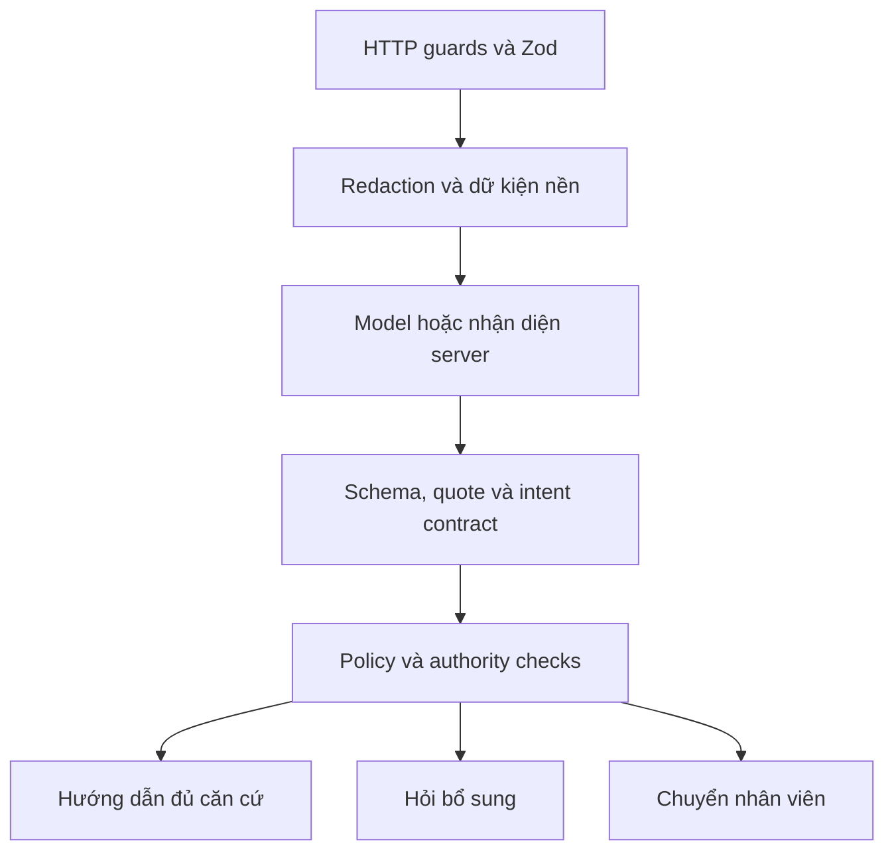
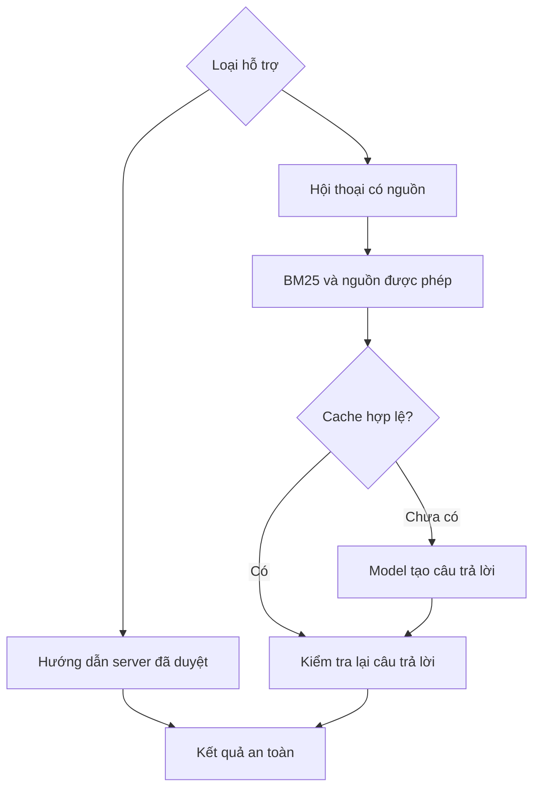
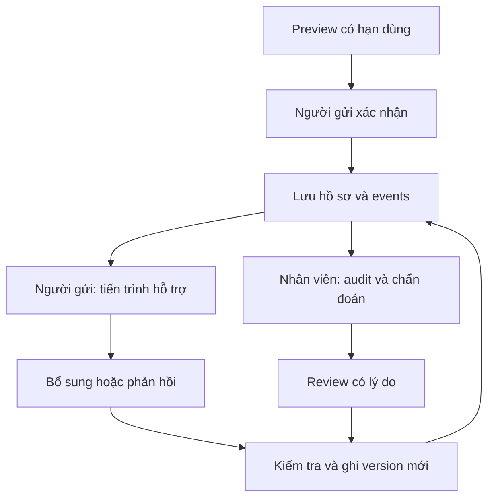

# Kiến trúc VNG Support

Ứng dụng Next.js App Router, TypeScript, React, MongoDB và adapter OpenAI. `src/domain/policy-source.ts` là nguồn phiên bản policy runtime; không lấy phiên bản từ một báo cáo lịch sử.

## Tiếp nhận và quyết định

- API kiểm tra origin, kích thước JSON, rate limit và ngữ cảnh identity/Verify phù hợp.
- Baseline giữ dữ kiện và rủi ro đã xác định; model không được xóa risk hoặc tự xác minh approval.
- Thứ tự ưu tiên: security risk → authority → missing information → routine. Policy, approval, entitlement và capacity có contract riêng.
- Khi mở port có rủi ro rõ, vẫn giữ thông tin được cung cấp như số cổng và quote; không tự suy diễn protocol hoặc nguồn/đích.
- Freeform đủ điều kiện dùng Structured Outputs và quote được kiểm chứng. Structured, reset mơ hồ và risk rõ có nhánh server riêng.
- Intent mơ hồ cần làm rõ, xung đột có bằng chứng vẫn được giữ. Lỗi model không được suy thành phê duyệt.

## Câu trả lời và độ trễ

`createConversationAnswer` truy xuất corpus bằng BM25, alias Việt–Anh và chuẩn hóa typo. Web search chỉ dùng khi được bật và đúng chủ đề/nguồn cho phép; URL trong ticket không cấp quyền đọc tài liệu riêng. Quote phải khớp bài nguồn; chỉ nguồn thực sự sử dụng mới được hiển thị. Nhãn conversation do server sở hữu, không bị model đổi quyền hay route.

Hướng dẫn đã duyệt đủ đáp ứng câu hỏi không cần thêm lượt AI chỉ để diễn đạt lại. Nguồn độc lập có thể được đọc song song; các bước phụ thuộc policy/quyền vẫn giữ thứ tự. Cache gắn revision và kiểm tra lại trước khi dùng, không cache câu trả lời riêng tư như câu công khai.

Model có deadline/retry giới hạn; không retry vô hạn hoặc bỏ evidence validation để đạt latency. Chỉ dùng dự phòng cho tác vụ mà server xác định đủ an toàn; giữ source, fallback reason và model metadata trong hồ sơ. Thông báo cho người gửi dùng ngôn ngữ dễ hiểu; mã kỹ thuật thuộc màn hình hỗ trợ.

`support-telemetry.ts` ghi thời gian từng stage, số lượt/token model và cache; không ghi input hay credential. `first_observed` không chứng minh Vercel cold start. Đo thời gian đến kết quả dùng được và tách cache hit/miss, thành công/fallback; không coi một sample là SLA.

## Lưu và hiển thị theo vai trò

Preview chưa tạo ticket; kiểm tra TTL, fingerprint và policy trước xác nhận. Request, assistance, feedback và events được ghi trong document `v3_support_requests`; cập nhật dùng version để chống ghi đè giữa các tab. Intake sentiment được lưu khi có phân tích, không chạy lại AI chỉ để hiển thị cho nhân viên. Hồ sơ cũ thiếu trường này vẫn đọc được và không được bịa dữ liệu bổ sung.

| Người gửi | Nhân viên hỗ trợ |
| --- | --- |
| Nội dung gốc, hướng dẫn, cảnh báo an toàn và nguồn tham khảo | Toàn bộ hướng dẫn và expected result |
| Trạng thái, thời gian và tiến trình dễ hiểu | Actor, action, rule, evidence, policy và lý do audit |
| Hỏi tiếp, bổ sung hoặc yêu cầu gặp nhân viên | Sentiment khi tiếp nhận và assessment của phản hồi |

Sentiment là thông tin quan sát, không tự cấp quyền, đặt ưu tiên, đóng ticket hoặc thay yêu cầu gặp người. Lựa chọn hiểu hướng dẫn không tự xác nhận sự cố thiết bị đã được giải quyết.

Đây là phân tách hiển thị theo màn hình. Bản demo chủ ý giữ reviewer/API demo công khai; không tuyên bố đây là ranh giới bảo mật giữa người gửi và nhân viên.

## Identity và dữ liệu

Identity dùng Mongo transaction, unique indexes, session và role server. Cấp ID gắn job/profile có phiên bản và scope cụ thể. Đăng nhập ID-only được giữ để demo nhanh; role `identity-admin` do operator gán, không suy từ tên job hoặc level CSV. Sổ quyền/quota DEMO-SANDBOX không tạo entitlement IAM thật.

Support và identity có collection riêng, có thể cùng database `vng_main`. Support có memory-demo khi được cấu hình rõ; identity không có memory/CSV fallback. Không sửa hoặc di chuyển dữ liệu Production từ workflow phát triển UI.

## Bản đồ code

| Trách nhiệm | Code |
| --- | --- |
| HTTP, input và redaction | [support-http](../src/lib/support-http.ts), [input](../src/domain/input.ts), [redaction](../src/domain/redaction.ts) |
| Phân tích và tiếp nhận | [support service](../src/services/support.ts), [support-model](../src/lib/support-model.ts), [intent contract](../src/lib/intent-contract.ts) |
| Policy và safety | [policy](../src/domain/policy.ts), [policy-source](../src/domain/policy-source.ts), [answer safety](../src/domain/answer-safety.ts) |
| Retrieval, câu trả lời và cache | [conversation-model](../src/lib/conversation-model.ts), [support-knowledge](../src/lib/support-knowledge.ts), [answer-cache](../src/lib/answer-cache.ts) |
| Hội thoại và review | [conversation](../src/services/conversation.ts), [review](../src/services/review.ts) |
| Lưu trữ và telemetry | [support-repository](../src/lib/support-repository.ts), [telemetry](../src/lib/support-telemetry.ts) |
| Identity | [identity service](../src/services/identity.ts), [identity-store](../src/lib/identity-store.ts) |
| Hiển thị | [support-history](../src/components/support-history.tsx), [review-detail](../src/components/review-detail.tsx) |

Không lưu chain-of-thought. Audit là nhật ký ứng dụng, không phải kho chống sửa bởi quản trị database. Redaction có phạm vi hữu hạn; xem [inventory](PRIVACY-INVENTORY.md). Policy mô phỏng, quyền demo và callback chưa tích hợp doanh nghiệp cần được phân biệt với xác thực, thông báo hoặc thực thi thật.
