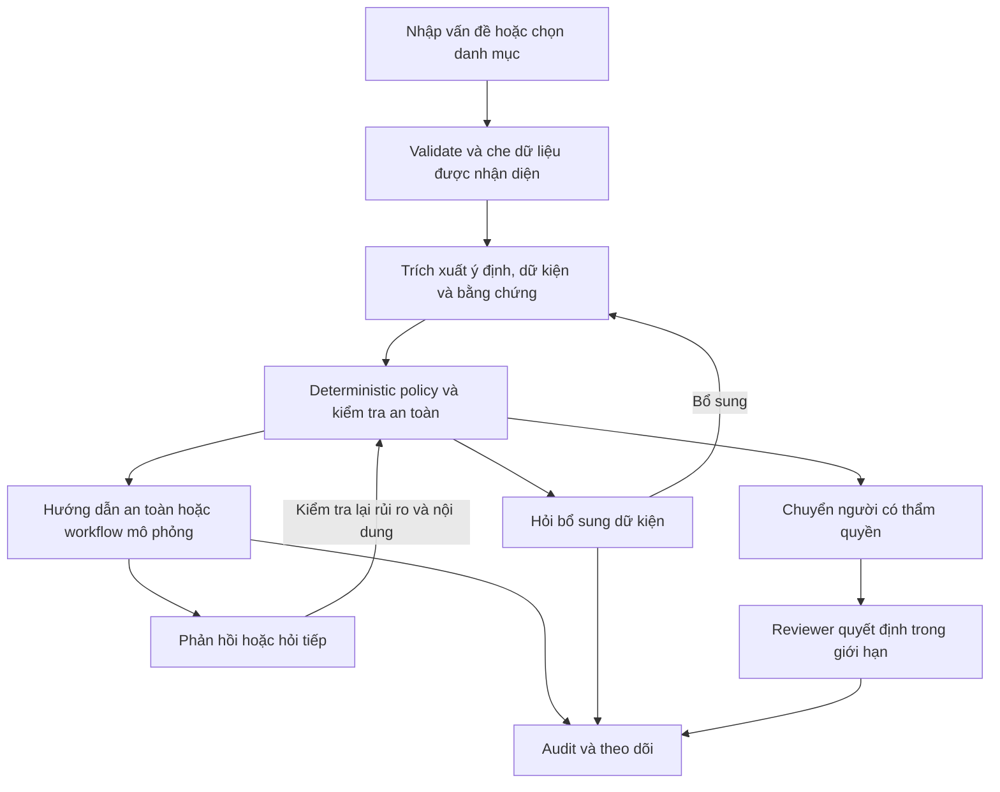

# Kiến trúc và các module VNG Support

### 1. Workflow tổng quát

- **Nhận diện ý định:** với `AI_PROVIDER=openai`, freeform đủ điều kiện được model chính phân tích cả khi là câu kể, có lỗi gõ hoặc diễn đạt khác. Input theo danh mục, rủi ro rõ ràng và “reset” cần làm rõ giữ đường kiểm tra deterministic; model không được đổi kết quả policy. Nếu có mô tả tự do, sentiment vẫn được model chính phân tích trong một lượt riêng ở các nhánh này. Provider `mock` dùng nhận diện và câu trả lời mô phỏng để chạy offline.
- **Quyết định:** Zod kiểm tra schema, evidence phải khớp input và nhánh xử lý phải nhất quán. Policy hiện tại `support-guidance-v5.14` (hiệu lực 14/10/2026) ưu tiên `SECURITY_RISK → BEYOND_AUTHORITY → MISSING_INFO → ROUTINE`. Approval chỉ hợp lệ khi cùng record khớp giữa registry/ITSM và đúng người, scope, role, quyền, environment, purpose, quota/TTL. Routine AUTO cần entitlement đã xác minh; sandbox cần quota project/team từ nguồn capacity thật. Ticket nhiều yêu cầu được yêu cầu tách riêng. Model không được tự phê duyệt hay bỏ qua rule. Lỗi model/schema/evidence chuyển xử lý an toàn.
- **Hướng dẫn có nguồn:** hội thoại tìm trong corpus có revision, nguồn và hạn sử dụng bằng BM25 kết hợp chuẩn hóa Việt–Anh/typo. Không dùng vector database hay embeddings. Web search chỉ bật riêng cho các chủ đề/nguồn cho phép; URL trong ticket không tự cho app quyền đọc tài liệu riêng.
- **Thiếu tài liệu công việc:** yêu cầu tạo/sửa một sản phẩm công việc mà chưa có tài liệu đầu vào được hỏi bổ sung cụ thể. App chưa có connector đọc Drive, repository, dashboard hoặc attachment riêng của người gửi; không giả vờ đã đọc tài liệu.
- **Sentiment trước khi gửi:** khi trích xuất ý định chạy, model chính trả thêm nhãn `positive`, `neutral` hoặc `negative` cùng bằng chứng và giải thích trong cùng phản hồi. Với input danh mục, rủi ro rõ hoặc “reset” mơ hồ, app gọi model chính chỉ để phân tích sentiment; deterministic policy vẫn giữ nguyên ưu tiên. Không có mô tả tự do thì ghi `not-assessed`. Người gửi rà soát kết quả trong preview. Khi model lỗi, provider từ chối do quota/rate limit hoặc đầu ra không hợp lệ, giao diện ghi rõ rule-based fallback; sentiment không thay đổi quyết định policy.
- **Sau câu trả lời:** cảm xúc chỉ là thông tin quan sát. Ticket chỉ hoàn tất khi người dùng xác nhận kết quả rõ ràng hoặc bấm nút xác nhận; nhãn positive không tự đóng ticket, negative không tự chuyển người. Rủi ro, authority và `USER_HANDOFF` vẫn qua policy trước. Lời cảm ơn/cảm xúc đơn thuần được ghi nhận và giữ yêu cầu mở. Xác nhận giải quyết có thể tạo gợi ý tri thức **chờ rà soát**, không tự thêm vào kho trả lời.
- **Truy vết:** audit ghi thời điểm, actor, trạng thái trước/sau, rule, evidence, giải thích và câu hỏi tiếp theo. Không lưu chain-of-thought. Preview gắn phiên bản policy; thay policy làm preview/cache cũ không được dùng lại.

`AUTO_APPROVE` có thể là cho phép trả hướng dẫn hoặc tiếp nhận workflow mô phỏng. Nó **không chứng minh máy đã được sửa, tài khoản đã được cấp quyền, cổng đã mở hoặc hạ tầng đã thay đổi**. Người dùng/reviewer xác nhận kết quả trong workflow; dự án chưa thực thi IAM/cloud/database thật.

[Rà soát tích hợp sentiment](../docs/archive/SENTIMENT-INTEGRATION-REVIEW.md) · [Nhận diện bằng model](../docs/archive/MODEL-INTENT-ROUTING.md) · [Retrieval](../docs/RAG-RETRIEVAL.md) · [Quản trị tri thức](../docs/KNOWLEDGE-REVIEW.md) · [Workflow theo bằng chứng](../docs/archive/EVIDENCE-WORKFLOW-FOLLOWUP.md)

### 2. Workflow chi tiết theo module

Sơ đồ dưới mô tả các nhánh xử lý và quan hệ giữa module; không phải mọi request đều đi qua mọi ô. Đường liền là luồng dữ liệu/xử lý, đường nét đứt là cấu hình, nguồn dữ liệu hoặc đối chiếu. Các ô ghi “M1”, “M6” tham chiếu lại module đó để tránh dây nối xuyên suốt sơ đồ. Nhánh preview → xác nhận là luồng UI; API submit có thể tự phân tích khi không gửi `previewId`. Có thể mở rộng/phóng to sơ đồ Mermaid trên GitHub để đọc từng nhánh.

```mermaid
flowchart TB
    subgraph INTAKE["M1 · Tiếp nhận và chuẩn hóa"]
        UI["Form tự do / danh mục / input mới"] --> HTTP["API boundary<br/>Origin, JSON, giới hạn body/rate<br/>Kiểm tra metadata hoặc phiên ID"]
        HTTP --> SAFE["Zod input + redaction<br/>Tách metadata nhân viên khỏi dữ kiện<br/>Bỏ field rỗng khi phân tích"]
        SAFE --> BASE["extractIntake<br/>Catalog, entity, risk, subrequest<br/>Phủ định và dữ kiện mâu thuẫn"]
    end

    subgraph INTENT["M2 · Nhận diện ý định"]
        BASE --> MODE{"Cách nhận diện"}
        MODE -->|"Structured / risk rõ / reset mơ hồ"| CANON["CanonicalRequest<br/>Facts + evidence + risk + route"]
        MODE -->|"Mock"| MOCK["conversationRoute / workEvidencePlan<br/>Nhận diện offline, không gọi API"]
        MODE -->|"OpenAI, freeform đủ điều kiện"| EXTRACT["extractWithModel · AI_MODEL<br/>Chat Completions → JSON"]
        EXTRACT --> CONTRACT["Schema + quote + route/catalog<br/>Giữ risk từ baseline<br/>Sai output → gắn modelFailure"]
        MOCK --> CANON
        CONTRACT --> CANON
        CANON --> WORK["Nếu thiếu tài liệu công việc:<br/>work-evidence + checkWorkSources<br/>Ghi nguồn đã kiểm tra và phần chưa có"]
    end

    subgraph POLICY["M3 · Quyết định cuối cùng"]
        CANON --> RULES["evaluatePolicy + policy-source<br/>Ưu tiên risk / authority / missing / routine<br/>Đánh giá từng subrequest"]
        WORK --> RULES
        APPROVAL["verifyApproval<br/>Scope, role, thời hạn<br/>Approval mô phỏng của dự án"] -.-> RULES
        RULES -->|"NEEDS_INFORMATION"| ASK["clarificationPlan<br/>Trường thiếu và câu hỏi cụ thể"]
        RULES -->|"ESCALATE"| ESC["Lý do + câu hỏi chuyển tiếp<br/>Nơi tiếp nhận và bước tiếp theo"]
        RULES -->|"AUTO_APPROVE"| HANDLE{"handlingMode / conversation"}
        HANDLE -->|"GUIDE"| GUIDE["guidanceTemplate<br/>Các bước do server định nghĩa"]
        HANDLE -->|"LLM_ASSIST, không phải chat"| ASSIST["AI_MODEL chọn bước mẫu<br/>Giải thích theo evidence<br/>Validate prose và bước được phép"]
        HANDLE -->|"SIMULATED_WORKFLOW"| SIM["Kết quả workflow mô phỏng<br/>Không thực thi IAM / cloud / DB"]
        ASSIST -->|"Lỗi → modelFailure"| RULES
    end

    subgraph RAG["M4 · Hội thoại có nguồn — createConversationAnswer"]
        HANDLE -->|"conversation"| RETRIEVE["Tra cứu corpus và web tùy chọn<br/>Chạy I/O song song"]
        CORPUS["knowledge.ts + knowledge-extra.ts<br/>Revision nguồn đã khai báo review"] -.-> FILTER["retrieveKnowledge / rankKnowledge<br/>Mongo hoặc seed local<br/>Schema, nội dung, expiry, superseded"]
        RETRIEVE --> FILTER
        FILTER --> RANK["searchKnowledge<br/>Chuẩn hóa, alias Việt–Anh, typo<br/>BM25 + title/keyword → tối đa 3 bài"]
        RETRIEVE --> WEB["retrievePublicWeb nếu được bật<br/>AI_WEB_MODEL hoặc AI_MODEL<br/>Responses API + web_search<br/>Query server, domain cho phép"]
        RANK --> CACHE["Context + nguồn<br/>withAnswerCache cho câu công khai hợp lệ"]
        WEB --> CACHE
        CACHE -->|"Miss / không cache"| ANSWER["AI_CONVERSATION_MODEL hoặc AI_MODEL<br/>JSON text + knowledgeIds + evidence"]
        CACHE -->|"Hit: vẫn kiểm tra lại"| VALIDATE["validateAnswer<br/>ID, quote, URL, prose/risk<br/>Chỉ trích nguồn thực sự sử dụng"]
        ANSWER --> VALIDATE
        ANSWER -->|"Lỗi gọi model"| FALLBACK
        VALIDATE -->|"Hợp lệ"| RESPONSE["Assistance.answer<br/>Nguồn, retrieval, cacheHit, fallbackReason"]
        VALIDATE -->|"Sai / lỗi model"| FALLBACK["Fallback deterministic từ corpus<br/>Hoặc hỏi rõ khi chưa có nguồn<br/>Không suy ra quyền nội bộ"]
        FALLBACK --> RESPONSE
        RETRIEVE -->|"Policy nội bộ chưa xác minh"| FALLBACK
    end

    subgraph LIFECYCLE["M5 · Preview, lưu và hội thoại tiếp"]
        ASK --> RESULT["Kết quả phân tích"]
        ESC --> RESULT
        GUIDE --> RESULT
        ASSIST --> RESULT
        SIM --> RESULT
        RESPONSE --> RESULT
        RESULT --> PREVIEW["previewSupport<br/>Fingerprint + policyVersion<br/>Preview TTL 10 phút, chưa tạo ticket"]
        PREVIEW --> CONFIRM["Người gửi xác nhận → submitSupport<br/>Idempotency, TTL, fingerprint<br/>Kiểm tra lại policy / approval"]
        CONFIRM --> SAVE["Tiếp nhận RECEIVED<br/>Sau đó lưu quyết định / assistance / events"]
        FOLLOWUP["clarifySupport / continueConversation / feedbackSupport<br/>Risk và USER_HANDOFF qua policy trước<br/>Sentiment chỉ quan sát, không đổi trạng thái<br/>Xác nhận kết quả / yêu cầu chuyển người tách riêng"] --> REANALYZE["Cần phân tích lại → M1–M4<br/>Sau đó lưu thay đổi qua M6"]
        FOLLOWUP -->|"Cập nhật trạng thái"| AUDIT
        REVIEW["reviewSupport<br/>Reason + transition + version<br/>Chặn duyệt Security risk / thiếu căn cứ"] --> AUDIT
        STORED["Hồ sơ đã lưu, đọc từ M6"] --> REVIEW
        STORED --> FOLLOWUP
    end

    subgraph STORAGE["M6 · Audit và lưu trữ Support"]
        SAVE --> AUDIT["auditEvent<br/>Actor, trước/sau, rule, evidence<br/>Policy version, lý do, câu hỏi"]
        AUDIT --> STORE[("v3_support_requests<br/>Request + assistance + feedback + events<br/>Ghi nguyên tử theo version<br/>Mongo hoặc memory-demo được phép")]
        STORE --> READ["Detail / events / metrics / auditPage<br/>Theo dõi, tìm HT, phân trang"]
    end

    subgraph IDENTITY["M7 · ID nhân viên — luồng riêng"]
        APPLY["Đơn họ tên + job/profile + scopes"] --> IDTX["identity service + identityTransaction<br/>Schema, profile/version, unique ID<br/>IT quyết định và ghi lý do"]
        AUTH["identity-auth<br/>ID ACTIVE → phiên demo<br/>ID + identity-admin → quyền duyệt demo"] --> IDTX
        IDTX --> IDDB[("MongoDB identity_* riêng<br/>Đơn + profile + tài khoản + audit<br/>Sessions / limits<br/>Không fallback memory hay CSV")]
        IDDB --> SCOPE["evaluateScope tại server<br/>Đúng scope và ít rủi ro mới allowed<br/>executed: false"]
        AUTH -.->|"Phiên người gửi"| IDREF["M1 kiểm tra ID khớp phiên nếu có"]
        AUTH -.->|"Access API: đánh giá demo, không thực thi"| SCOPE
    end

    subgraph VERIFY["M8 · Verify và đánh giá"]
        PACK["Verify packs 4 / 5 / 15<br/>createVerifyRun + executeVerifyCase"] --> VAPI["Gọi cùng API M1–M6<br/>Không hard-code quyết định theo case ID"]
        VAPI --> CHECK["runSupportCase<br/>Đối chiếu expected với readback từ M6<br/>Detail + events + queue + metrics"]
        CHECK --> RUNDB[("v3_verify_runs<br/>Lưu case ID, request ID, kết quả<br/>Dừng / tiếp tục")]
        EVAL["evaluation + escalation-threshold<br/>Metric từ nhãn caller khai báo<br/>Đề xuất ngưỡng, không tự kích hoạt"]
    end

    %% Invisible links only arrange the independent modules vertically.
    STORAGE ~~~ IDENTITY
    IDENTITY ~~~ VERIFY

    classDef authority fill:#fff0e6,stroke:#b83b0b,color:#202124;
    classDef data fill:#eef4fa,stroke:#46627f,color:#202124;
    class RULES,CONTRACT,VALIDATE,REVIEW,SCOPE authority;
    class STORE,IDDB,RUNDB,CORPUS data;
```

#### Model nào làm việc gì?

Tên model chính **được lấy từ cấu hình**, không hard-code một phiên bản GPT trong luồng runtime. `.env.example` đề xuất `AI_MODEL=gpt-6-luna`, để `AI_CONVERSATION_MODEL` rỗng và giữ `AI_PROVIDER=mock` cho kiểm thử offline. Chuyển Production sang Luna theo yêu cầu chủ repo cần `AI_PROVIDER=openai`, `AI_MODEL=gpt-6-luna` và API key hợp lệ có quyền model. Health chỉ báo cấu hình (`modelConnectivity=NOT_CHECKED`), không chứng minh inference đã thành công.

Adapter hiện có trong repo chọn `reasoning_effort=none` riêng cho Luna, giữ timeout/token cap và `store:false`. Production không áp dụng hạn mức số lần gọi model theo ngày ở cấp ứng dụng; Luna cũng không có bộ đếm riêng. Provider vẫn áp dụng quota/rate limit tài khoản, timeout và token cap vẫn có hiệu lực. Bộ test dùng `AI_TEST_MAX_ATTEMPTS` làm guard riêng để tránh gọi provider ngoài ý muốn. Preview hiển thị mã lỗi an toàn khi fallback, gồm xác thực 401, rate limit, timeout hoặc output/evidence không hợp lệ; không hiển thị lỗi thô hoặc credentials. [Chẩn đoán và bằng chứng](../docs/archive/SENTIMENT-MODEL-DIAGNOSTICS.md).

| Công đoạn | Model / cơ chế | Đầu ra và giới hạn |
| --- | --- | --- |
| M2 — hiểu câu kể/câu hỏi | `AI_MODEL`, qua `callModel` / Chat Completions khi provider OpenAI | JSON facts, intent, route, quotes; sau đó kiểm tra schema/evidence và hợp nhất risk. Không ra quyết định cấp quyền. |
| M3 — hướng dẫn đơn giản | `guidanceTemplate`, không cần LLM sinh câu trả lời | Bước hướng dẫn cố định theo catalog. |
| M3 — trợ giúp có giải thích | `AI_MODEL` | Chọn chỉ số bước từ template và giải thích theo evidence; không tạo thêm thao tác, command hay quyền. |
| M4 — trả lời hội thoại | `AI_CONVERSATION_MODEL`, để trống thì dùng `AI_MODEL` | JSON gồm text, knowledgeIds và trích dẫn evidence; model đọc context đã truy hồi, server kiểm tra trước khi hiển thị. |
| M4 — tìm web công khai | `AI_WEB_MODEL`, để trống thì dùng `AI_MODEL`; giá trị mẫu là `gpt-4.1` | Responses API với `web_search`, chỉ khi `AI_WEB_SEARCH=true` và đủ cấu hình. Tối đa một tool call; không gửi nguyên ticket làm query tìm kiếm. |
| Policy và retrieval | TypeScript deterministic và BM25 | Không có model embedding hoặc reranker. |
| Sentiment yêu cầu mới trong preview | Cùng phản hồi model phân tích ý định (`AI_MODEL`) khi đủ điều kiện; với nhánh deterministic, một lượt sentiment riêng dùng `AI_MODEL`; rule-based làm fallback | Cụm bằng chứng phải là nguyên văn trong input; sentiment không tác động policy. Mock, thiếu mô tả, lỗi model hoặc lỗi quota/rate limit của provider được ghi rõ. |
| Sentiment sau câu trả lời | Model hội thoại (`AI_CONVERSATION_MODEL`, hoặc `AI_MODEL` nếu để trống) khi `AI_PROVIDER=openai`; rule-based làm fallback | Model trả một nhãn `positive`, `neutral` hoặc `negative` theo schema. Rủi ro vẫn được kiểm tra trước sentiment; mock, timeout hoặc lỗi đầu ra dùng rule-based fallback. |

`callModel` đặt `store: false`, tối đa 1.000 completion tokens, timeout tối đa 12 giây và `maxRetries: 0`; web đặt tối đa 1.000 output tokens và timeout 18 giây. Production không áp hạn mức số lần gọi model theo ngày ở cấp ứng dụng; mỗi lần gọi thật vẫn có thể phát sinh chi phí và chịu rate limit/quota của OpenAI. API intake của demo vẫn giới hạn 30 request/phút trên mỗi client để chống spam. Bộ test dùng `AI_TEST_MAX_ATTEMPTS` riêng, không phải quota production. `workflow-prompt.ts` bổ sung nguyên tắc làm việc theo bằng chứng cho extraction/assistance qua `callModel`, không áp vào lời gọi sentiment riêng; nó không thay policy. Sentiment model giới hạn 128 completion tokens và timeout 6 giây; lỗi/schema/evidence không hợp lệ dùng fallback có nhãn nguồn.

#### RAG đi từ tài liệu đến câu trả lời ra sao?

1. **Nguồn đầu vào:** `knowledge.ts` và `knowledge-extra.ts` định nghĩa bài, keyword, label, URL nguồn, phạm vi public/project, revision và thời hạn. `retrieveKnowledge` dùng seed local khi chạy memory-demo; khi có Mongo, upsert bằng `$setOnInsert` vào `v3_support_knowledge`, không âm thầm sửa revision cũ. Chưa có pipeline upload/chunk tài liệu người dùng hoặc embedding.
2. **Lọc trước khi tìm:** `rankKnowledge` kiểm tra Zod, loại revision đã bị thay thế/hết hạn/ngày review trong tương lai và yêu cầu nội dung khớp manifest trong code. Biết một article ID không đủ để coi nội dung Mongo đáng tin. Khi truy hồi lỗi, lớp hội thoại có thể dùng corpus local hợp lệ và ghi `retrieval=unavailable`; đây không phải fallback lưu ticket.
3. **Xếp hạng:** `searchTokens` chuẩn hóa không dấu, alias Việt–Anh, loại stopwords và sửa lệch một ký tự cho từ đủ dài. `searchKnowledge` dùng BM25, tăng điểm title/keyword và gợi ý label; bài kỹ thuật cần khớp từ, khớp title/keyword và score tối thiểu 2. Nhãn chào hỏi/giới thiệu có xử lý riêng. Trả tối đa **3 bài**, có thể trả rỗng; không ép chọn một bài cho mọi câu hỏi.
4. **Web là nguồn bổ sung tùy chọn:** lookup corpus và web chạy song song bằng `Promise.all`. Chỉ nhãn thông tin công ty/Cloud-GPU có web plan, domain được giới hạn ở nguồn công khai VNG/Cloud/GreenNode; yêu cầu policy nội bộ không được biến thành tra cứu để suy ra entitlement. Web cache trong Mongo có TTL 24 giờ và được kiểm tra lại nguồn/nội dung khi đọc.
5. **Tạo và kiểm tra câu trả lời:** context gồm câu hỏi, các bài đã chọn, web text và scope nguồn. `validateAnswer` kiểm tra ID được phép, quote có trong bài/web text, URL thuộc nguồn, dấu hiệu injection, secret, command và phát biểu cấp quyền. Trích dẫn đúng chuỗi **không chứng minh toàn bộ diễn giải đúng nghĩa**. Chỉ nguồn được câu trả lời sử dụng mới hiện ở UI.
6. **Cache/fallback:** answer cache chỉ áp dụng danh sách câu hỏi công khai hẹp, khóa theo câu hỏi/label/model/policy/corpus, TTL 1 giờ, có chữ ký HMAC và kiểm tra lại output khi hit. Câu hỏi cá nhân/hỏi tiếp không vào shared cache; lookup nguồn vẫn diễn ra trước kiểm tra answer cache. Nếu sinh/validate câu trả lời lỗi, nhánh hội thoại dùng bài phù hợp đầu tiên hoặc hỏi rõ và ghi `fallbackReason`. Lỗi extraction hoặc trợ giúp chẩn đoán đi theo `modelFailure` rồi policy, không dùng cùng một fallback cho mọi lỗi.

Gợi ý tri thức từ ticket đã giải quyết chỉ là `PENDING_REVIEW`. Người phụ trách kiểm tra nguồn và biên tập revision theo [quy trình knowledge](../docs/KNOWLEDGE-REVIEW.md); không có mũi tên tự động từ feedback/model output vào corpus được dùng để trả lời.

#### Audit giải quyết việc truy vết và xung đột như thế nào?

**Support:** `auditEvent` tạo event gắn với request: `timestamp`, `actor`, `beforeStatus/afterStatus`, `action`, `bucket`, `ruleIds`, `safeEvidence`, dữ kiện thiếu, câu hỏi, bước tiếp theo, `policyVersion`, thông tin approval và kết quả từng subrequest. Luồng lưu đầu tiên ghi `RECEIVED`, rồi `DECISION` và `ANSWER` khi có câu trả lời hội thoại; các thao tác sau ghi event tương ứng như clarification, feedback, conversation hoặc review. Metadata nguồn/RAG nằm trong assistance và event `ANSWER`; không lưu chain-of-thought.

Request, assistance, feedback và mảng `events` cùng nằm trong **một document** `v3_support_requests`. `updateSupportRequest` dùng `_id + data.version` khi ghi thay thế document: thao tác thắng tăng version và lưu dữ liệu/event cùng nhau; tab dùng version cũ nhận 409 để tải lại. Tiếp nhận và hoàn tất phân tích là hai lần ghi, không phải một transaction bao trùm mọi API/model call; idempotency/fingerprint giúp xử lý retry mà không tạo hồ sơ khác cho cùng nội dung.

`/api/support/events` và `support-query.ts` đọc các event đã lưu để phục vụ lịch sử, bộ lọc và phân trang; metrics/Verify đối chiếu dữ liệu ứng dụng thay vì sinh KPI giả. Đây là audit ở mức app, **không phải kho WORM hoặc nhật ký chống sửa bởi quản trị viên database**. Actor reviewer công khai là `public-demo-reviewer`, không chứng minh danh tính người thật. Redaction có phạm vi hữu hạn như phần giới hạn bên dưới.

**Identity:** `identityAudit` lưu riêng vào collection `identity_audit`. Đơn đăng ký và quyết định cấp ID/profile/account được ghi cùng audit qua Mongo transaction; unique index và version guard chặn cấp trùng/ghi đè quyết định. Phiên và bộ đếm có collection riêng; không phải mọi thao tác rate-limit đều ghi một audit event. Quyền xem audit/duyệt ID cần phiên đăng nhập ID cùng role `identity-admin`; khác với audit Support public demo.

#### Bản đồ module nhỏ và nơi đọc code

| Module | Thành phần chính | Điểm vào mã nguồn |
| --- | --- | --- |
| M1 — Intake | HTTP guards, input schema, employee metadata, redaction, baseline extraction | [support-http](../src/lib/support-http.ts), [input](../src/domain/input.ts), [text](../src/domain/text.ts), [redaction](../src/domain/redaction.ts) |
| M2 — Intent | Model adapter, route/catalog contract, conversation routing, work evidence/source checks | [support service](../src/services/support.ts), [support-model](../src/lib/support-model.ts), [conversation domain](../src/domain/conversation.ts), [work-evidence](../src/domain/work-evidence.ts) |
| M3 — Policy | Rule priority, approval scope, missing facts, targeted questions, safe guidance/prose | [policy](../src/domain/policy.ts), [policy-source](../src/domain/policy-source.ts), [approvals](../src/services/approvals.ts), [questions](../src/domain/questions.ts), [guidance](../src/domain/guidance.ts), [answer-safety](../src/domain/answer-safety.ts) |
| M4 — RAG | Corpus, schema/revision filter, BM25, optional web, answer validation/cache | [knowledge](../src/domain/knowledge.ts), [knowledge-extra](../src/domain/knowledge-extra.ts), [support-knowledge](../src/lib/support-knowledge.ts), [knowledge-search](../src/domain/knowledge-search.ts), [conversation-model](../src/lib/conversation-model.ts), [answer-cache](../src/lib/answer-cache.ts) |
| M5 — Lifecycle | Preview/confirm, hỏi rõ/hỏi tiếp, sentiment, reviewer, transition guards | [support](../src/services/support.ts), [conversation service](../src/services/conversation.ts), [review](../src/services/review.ts), [feedback](../src/domain/feedback.ts), [transitions](../src/domain/transitions.ts) |
| M6 — Storage/audit | Atomic request document, optimistic version, audit query, metrics | [support-repository](../src/lib/support-repository.ts), [support-query](../src/lib/support-query.ts), [events API](../src/app/api/support/events/route.ts), [metrics API](../src/app/api/support/metrics/route.ts) |
| M7 — Identity | ID formula, job/version/scope, application/decision, ID/session, transaction/audit | [identity domain](../src/domain/identity.ts), [identity service](../src/services/identity.ts), [identity-store](../src/lib/identity-store.ts), [identity-auth](../src/lib/identity-auth.ts) |
| M8 — Verify/evaluation | Pack, execution, readback, resume, metrics, bounded threshold proposal | [verification](../src/services/verification.ts), [support-verify](../src/lib/support-verify.ts), [verify-repository](../src/lib/verify-repository.ts), [evaluation](../src/services/evaluation.ts), [escalation-threshold](../src/domain/escalation-threshold.ts) |
