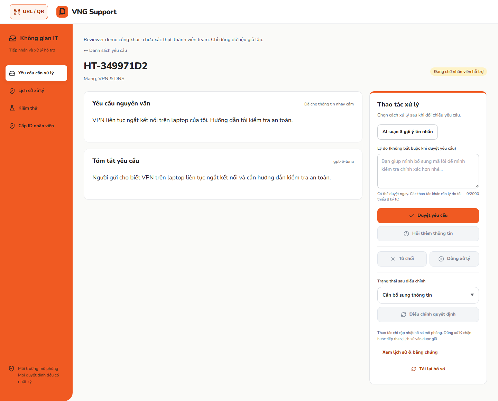

# Phòng ban demo, tin nhắn và tóm tắt Luna — 17/10/2026

Đây là báo cáo lịch sử tại 6edafe2. Lượt sửa và kiểm chứng ba tin nhắn Luna đầy đủ sau đó nằm trong [báo cáo dbd3578](LUNA-FULL-REPLIES-2026-10-17.md); các fallback dưới đây được giữ nguyên làm bằng chứng trước sửa.

## Phạm vi và phiên bản

AI-assisted implementation/verification bằng Codex, dữ liệu hoàn toàn giả lập; không phải phản hồi của người dùng thật.

- Base của lượt đồng bộ phòng ban: `d25edfd03b4e892382c9223d70f3e744484d9f7a`.
- [796b1fd](https://github.com/dakiemdarktharr/vng-support/commit/796b1fd5c9657f9e48e1ceca80aefa9f882033c3): phòng ban trong manifest, form, guest và README dùng cùng 9 lựa chọn.
- [f0246e8](https://github.com/dakiemdarktharr/vng-support/commit/f0246e858542653b83a3328811fa4840d154937b): giữ evidence thiết bị VPN và chấp nhận lời dẫn tự nhiên dùng “mình” hoặc “bạn”.
- [6edafe2](https://github.com/dakiemdarktharr/vng-support/commit/6edafe202669d9a3d70805c2f4e5cbae6acd69bb): mặc định chỉ hiện nguyên văn + tóm tắt; mở lịch sử/bằng chứng khi cần.
- Production UI/API đã kiểm tra đúng `6edafe202669d9a3d70805c2f4e5cbae6acd69bb`; [Vercel deployment](https://vercel.com/acne-a6cd/vng-support/DBmTJoWuNTzQ5Xn27XN3AES5BUPW). OpenAI / gpt-6-luna, MongoDB `vng_main`, policy `support-guidance-v5.20`.
- Không sửa policy nghiệp vụ, Ground Truth, quyền của 40 ID hoặc giới hạn model/rate limit. Checkout dirty của người dùng tại D:/ChatGPT/mlai26/vng-support-connectivity được bảo toàn; tích hợp từ checkout riêng.

## 40 ID và migration Mongo Production

Đối chiếu phòng ban với dropdown: Công nghệ thông tin 9, Kỹ thuật 8, Sản phẩm 5, Kinh doanh 4, Marketing 3, Tài chính 3, Nhân sự 3, Vận hành 4, Khác 1. Vị trí công việc không phải phòng ban.

Migration transaction chỉ thêm department cho **40/40** bản ghi đã được xác minh đúng batch/tên/profile/scope, tạo 40 audit DEMO_DEPARTMENT_ASSIGNED. Không tạo tài khoản/profile mới. Hash mọi trường tài khoản trừ department, toàn bộ profile version và tài khoản IT không đổi. Chạy lại: 40 unchanged, không thêm audit. Manifest SHA256: `be285a2947a8655196c2a19dfa0339e4fac89b3231569308dbdd20ee881626ae`.

Kiểm tra Production một ID đại diện cho mỗi phòng ban: **9/9** đăng nhập, session trả đúng phòng ban, scope đúng bucket, không có quyền cấp ID (403), đăng xuất thành công. Đây không phải kiểm tra lại đăng nhập cả 40 ID. Scope toàn bộ roster vẫn 29 routine / 9 authority / 2 security.

## Giao diện và hợp đồng tóm tắt

Nguyên văn giữ bản người gửi đầu tiên đã redact; bản tóm tắt dùng original/latest, trường yêu cầu không định danh và tối đa ba phản hồi gần nhất. Luna trả JSON strict, server kiểm tra schema, trích dẫn nguyên văn, số, secrets và các mẫu lệnh/khẳng định phê duyệt bị cấm. Những guard này không chứng minh mọi diễn giải ngôn ngữ đều hoàn hảo; reviewer vẫn đối chiếu với nguyên văn.

Tóm tắt là công cụ đọc nhanh, không đi vào policy/routing/approval và không được tự gửi cho người yêu cầu. AI lỗi vẫn đọc và xử lý hồ sơ được. Mở **Xem lịch sử & bằng chứng** để xem dữ kiện, hướng dẫn, sentiment, phòng ban, thời điểm, rule và audit. Giữ thao tác bàn phím, bố cục mobile và thanh chờ có reduced-motion.

Cache ở Mongo `v3_support_reviewer_summaries`, riêng từng request + nội dung + prompt version + provider/model, TTL 24 giờ. Cache hit sau reload đã xác minh thật trên cả 3 hồ sơ; không gọi đây là chứng minh persistence sau restart. Single-flight chỉ trong một process; các instance đồng thời vẫn có thể gọi trùng trước lần ghi đầu.

[Ảnh mobile](images/review-summary-mobile.png).

## Kết quả Production mới nhất

Mỗi ca tạo hồ sơ riêng. Máy in/VPN chuyển người bằng feedback ADMIN, giữ hướng dẫn đã gửi; mở cổng giữ escalation bảo mật. Mỗi lần tạo draft không đổi version/audit, chọn draft chưa gửi; bấm thao tác reviewer mới lưu và gửi tin nhắn. Nguồn draft được báo riêng, không nhầm với nguồn tóm tắt.

| Input nguyên văn | Tóm tắt | 3 gợi ý trả lời | Người gửi nhận tin nhắn |
| --- | --- | --- | --- |
| Máy in văn phòng báo kẹt giấy. Tôi nên kiểm tra gì trước? | openai / gpt-6-luna; cache hit sau reload | openai / gpt-6-luna | PASS: polling, reload, audit và lịch sử |
| VPN liên tục ngắt kết nối trên laptop của tôi. Hướng dẫn tôi kiểm tra an toàn. | openai / gpt-6-luna; cache hit sau reload | deterministic (mẫu server) | PASS: polling, reload, audit và lịch sử |
| Mở port 3389 ra Internet để truy cập từ xa vào máy công ty. | openai / gpt-6-luna; cache hit sau reload | deterministic (mẫu server) | PASS: polling, reload, audit và lịch sử |

Ba bộ gợi ý đều giữ thứ tự **QUESTION, ANSWER, ANSWER**. Tin nhắn được chọn khớp nguyên văn với tin nhắn người gửi thấy trên mobile, polling, reload và senderMessage trong audit. Hướng dẫn cũ không đổi. Đây là thông báo trong app, không phải email/push hoặc xác nhận người dùng thật đã đọc.

**Kết luận đúng phạm vi:** tóm tắt Luna thật **3/3**, cache reload **3/3**, gửi/nhận tin nhắn **3/3**; draft dùng Luna thật **1/3** ở lượt mới nhất. Hai ca còn lại dùng mẫu server với `DRAFT_UNAVAILABLE_OR_INVALID`, không được tính là model thành công. Trước đó trên f0246e8, máy in và VPN đều có draft OpenAI hợp lệ (3.111 ms và 3.311 ms), còn mở cổng fallback. Giữ cả hai lượt, không chỉ chọn kết quả đẹp.

## Thời gian quan sát

Đơn vị ms, 3 hồ sơ tuần tự, không kiểm soát cold/warm. Tóm tắt đo từ bắt đầu mở/reload trang đến response summary; draft đo từ bấm nút đến response. Không phải thời gian model thuần, không đủ mẫu để suy ra p95/SLA hay mức tải 3.000 người.

| Ca | Mở trang + summary miss | Reload + summary hit | Soạn draft (kể cả fallback) |
| --- | ---: | ---: | ---: |
| printer-question | 6595 | 293 | 3146 |
| vpn-answer | 1694 | 213 | 2877 |
| security-answer | 8405 | 239 | 2606 |

## Kiểm tra và các lỗi đã giữ lại

- `npm test`: **1.377 pass, 1 skip**; skip là benchmark đo intent local có điều kiện SUPPORT_INTENT_BENCH=1, không phải một lần inference live. Không coi mock là model thật.
- 38 script tests (Mongo smoke guard, development report, docs, identity roster/rename): **38 pass**.
- `npm run lint -- --ignore-pattern 'artifacts/production-ops-20261017/**'`: pass, chỉ loại các script/SDK bundle chẩn đoán local không phát hành. Lint các source/test thay đổi cũng pass; CI lint toàn checkout đã pass.
- `npm run typecheck`, `npm run build`, `npm run check:docs`, `git diff --check`: pass.
- E2E production build local, **mock/memory**, port 3227: lần gộp hai projects đầu có 198 pass, 11 fail, 1 skip. Lỗi gồm selector lịch sử/nhãn cũ sau đổi UI, giả định rule trong test UI mới, và Verify mobile chạm rate window do dùng chung server. Không đổi expected của fixture policy. Test summary chuyển sang đối chiếu nguyên audit đã lưu vì mục tiêu là giữ lịch sử, không đo routing.
- Rerun desktop có 104 pass/1 lỗi script test mở lại panel đã mở; bỏ thao tác dư và chạy lại cả it-review: **3/3 pass**. Mobile chạy server riêng như CI: **104 pass, 1 skip** (video chỉ desktop). Không hạ hoặc đặt lại rate limit. [CI đúng commit](https://github.com/dakiemdarktharr/vng-support/actions/runs/39005316184) đã **SUCCESS** trên checkout sạch: desktop **105/105 pass**, mobile **104 pass / 1 skip**, toàn bộ unit/guards/lint/typecheck/build đạt. CI test:persistence tự **SKIP** vì không có URI/ack Mongo cô lập; không thử kết nối hoặc báo persistence thành công.
- Lỗi Production trước sửa: guest Marketing 422 do enum cũ chỉ có 6 phòng ban; VPN chứa “laptop” bị MODEL_EVIDENCE_INVALID do catalog chưa cho phép deviceType; lời dẫn dùng “mình” bị kiểm tra phong cách yêu cầu “bạn” từ chối. Hai lỗi code và mapping đã có regression. Fallback draft vẫn được ghi nhận như bảng trên; lý do tổng quát hiện chưa phân biệt chi tiết provider/schema/evidence/style, nên không khẳng định nguyên nhân chính xác cho hai fallback mới nhất.

## Cleanup và bằng chứng

Đã lưu snapshot các hồ sơ giả lập trước cleanup. Transaction xóa chính xác **8 request + 3 summary cache** theo ID/version/fingerprint/createdAt đã kiểm chứng; một key bị từ chối 422 trước đó chưa từng có bản ghi. Read-back tất cả 9 ID/key: HTTP404 và summary count0. Giữ 40 audit migration, audit login/scope, bộ đếm và dữ liệu nghiệp vụ. SHA256 snapshot trước dọn: `946231fdb04277daca5eeff3cab9cfc1bf8e2578c9a74f7c5461b6e13179968e`.

Bằng chứng local: thư mục `deliverables/VNG_Support_2026-10-17` của workspace, gồm migration.json, live-results.json, pre-fix-live-results.json, pre-summary-live-results.json, created-requests.json, cleanup-before.json, cleanup.json, ảnh desktop/mobile và kết quả E2E. Không commit raw runtime artifacts hoặc credentials.

## Giới hạn còn lại

- Draft vẫn có lượt rơi về mẫu dự phòng: giữ nguồn hiển thị đúng, chưa phân loại được nguyên nhân chi tiết của hai lượt mới nhất; không bỏ kiểm tra an toàn chỉ để tăng tỷ lệ model.
- `persistenceVerification=NOT_PERFORMED`: migration/read-back và cache hit thật không thay thử Mongo qua restart.
- ID-only và reviewer public vẫn là demo; chưa phải xác thực production hay phân quyền theo team.
- Bộ kiểm tra này dùng synthetic data; không phải nghiên cứu người dùng, held-out độc lập hoặc chứng nhận 9,5/10.
