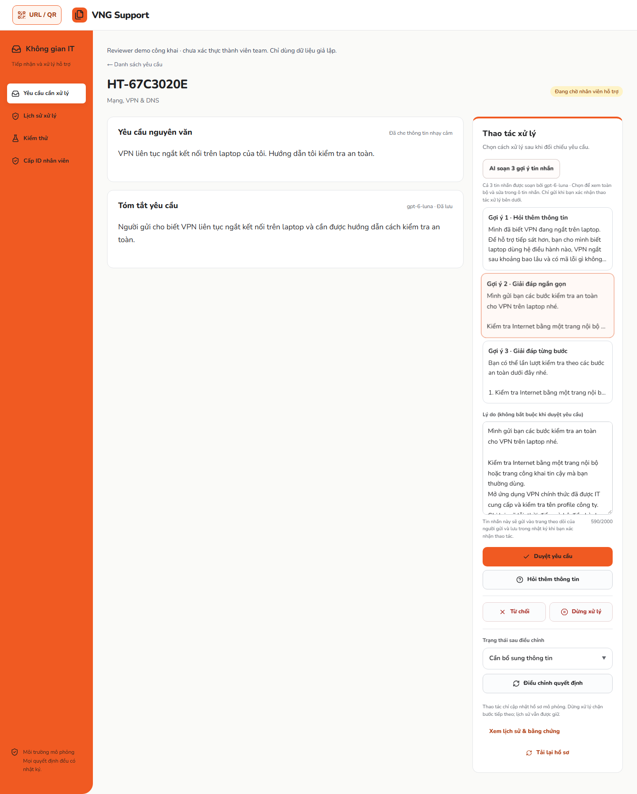

# Ba tin nhắn hoàn chỉnh từ Luna — 17/10/2026

AI-assisted implementation và kiểm chứng bằng Codex; dữ liệu giả lập, không phải feedback người dùng thật.

## Phiên bản và nguyên nhân

- Base đọc từ GitHub/Production: `4629de6918f7dcae77fba66654354088f3e28b0e`.
- Tích hợp main mới `cbedebf96a17dd81ed81431e16e6a62c8d8d186f`, gồm thay đổi thống nhất mã yêu cầu của lượt làm việc khác.
- Code: [4b44bf8](https://github.com/dakiemdarktharr/vng-support/commit/4b44bf883f962d240e09ef31e3465dd5a0af6f18).
- Candidate: [dbd3578](https://github.com/dakiemdarktharr/vng-support/commit/dbd35780af3218637b367a2802b530a617d61fb3).
- Bảo toàn checkout người dùng; sửa trong checkout tích hợp riêng. Chỉ stage file nguồn, test và tài liệu thuộc nhiệm vụ. Không sửa policy, Ground Truth, quyền nhân viên, model, quota hoặc hạn mức số lần gọi.

Bản cũ chỉ nhờ model viết câu hỏi/lời dẫn rồi ghép mẫu server. Tái hiện bằng Luna thật trên snapshot giả lập trong bộ nhớ local: máy in hợp lệ, VPN và Security dùng fallback. VPN đổi chữ thường thành chữ hoa trong quote (“giữ” thành “Giữ”) nên không khớp nguyên văn. Security diễn giải nhu cầu mở cổng bị bộ nhận diện rủi ro coi là chỉ dẫn thực hiện. Dẫn chứng kiểu tên thuộc tính JSON cũng có thể lọt qua kiểm tra substring cũ.

## Hợp đồng mới

Luna trả trọn ba `text` theo thứ tự QUESTION/ANSWER/ANSWER qua schema strict: một tin hỏi bổ sung, hai tin giải đáp theo đoạn/từng bước. Server trả nguyên nội dung sau validation; không ghép thêm đoạn mẫu để giả như toàn bộ do AI soạn. Hai câu trả lời phải giữ các đoạn hướng dẫn đã duyệt, đầy đủ và đúng thứ tự, gồm cảnh báo/điều kiện dừng. Phần viết thêm dùng bạn/mình, không được thêm thao tác hay hứa đã cấp quyền/khắc phục.

Luna chọn `evidenceIds` trong danh sách server. API dẫn xuất nguyên văn nguồn tương ứng; không tin quote do model sửa hay tên thuộc tính JSON. Bộ kiểm tra tách đoạn policy/cảnh báo đã đối chiếu khỏi phần prose mới; không nhầm lời nhắc “không gửi mật khẩu” với xin mật khẩu. ID nguồn giả, thiếu/đảo bước, lệnh mới, secrets, lời xác nhận không có căn cứ và dữ liệu sai schema đều bị từ chối.

Một inference, deadline tối đa 12 giây, không retry thêm. Giới hạn output riêng cho ba tin nhắn đầy đủ tăng từ 700 lên 2.200 token; giới hạn tin nhắn vẫn 2.000 ký tự, hạn mức lượt gọi/rate limit giữ nguyên. API trả attempts/latency và mã fallback đã lọc; fallback luôn gắn nguồn deterministic. Chọn bản nháp không gửi hoặc thay trạng thái: reviewer phải xác nhận thao tác.

File chính: `src/services/review-drafts.ts`, `src/domain/review-drafts.ts`, `src/components/review-drafts.tsx`, hai bộ test draft và hướng dẫn README/USAGE/BATCH-SUPPORT-CONTRACT.

## Kiểm tra local

- `npm test`: **1.405 pass, 1 skip**, 72 file pass. Skip là benchmark intent có opt-in, không phải bỏ qua lỗi.
- 38 script tests Mongo guard/development report/docs/identity roster/rename: **38 pass**.
- `npm run lint -- --ignore-pattern 'artifacts/**'`, `npm run typecheck`, `npm run build`, `npm run check:docs`, `git diff --check`: **PASS**. Lint toàn checkout cũng chạy: 0 lỗi, 10 warning từ hai bundle chẩn đoán không phát hành; không đổi cấu hình lint.
- Production build local, provider mock/memory, server 3227: `batch-support`, `review-summary`, `reviewer-usability` — **12/12 desktop, 12/12 mobile**. Build và E2E chạy tuần tự; không đổi hạn mức.
- 28 regression mới kiểm tra nội dung đầy đủ, dẫn chứng sai, thiếu/đảo bước, nguy hiểm, credential, phủ định, văn phong, timeout/401/truncation và race version. Giữ các kiểm tra gửi/nhận/audit có sẵn.
- [CI đúng candidate dbd3578](https://github.com/dakiemdarktharr/vng-support/actions/runs/39007135198): **SUCCESS** trên checkout sạch. Toàn bộ unit/script/lint/typecheck/build/docs đạt; E2E đầy đủ **105 desktop pass**, **104 mobile pass / 1 skip** (video chỉ desktop). Mongo restart integration **SKIP, persistenceVerification=NOT_PERFORMED** vì không có URI/ack của database thử cô lập; không kết nối Mongo trong CI.

Lỗi được giữ trong bằng chứng: candidate đầu còn từ chối câu “chưa thể hỗ trợ mở cổng”; sửa kiểm tra phủ định và thêm regression. Test cảnh báo không gửi nhiều loại credential ban đầu thất bại; đã sửa và chạy lại. Khi tích hợp main, test search phụ thuộc chữ hoa nội bộ thất bại; sửa assertion để vẫn yêu cầu đúng mã và matching không phân biệt hoa/thường, không đổi Ground Truth hay hành vi search.

## Inference local thật

Cùng ba snapshot giả lập, cùng OpenAI/gpt-6-luna; storage bộ nhớ, không ghi Mongo. Giữ cả các lượt thất bại, không chọn lọc kết quả:

| Lượt | Máy in | VPN | Mở port Internet |
| --- | --- | --- | --- |
| Baseline | OpenAI, 3301 ms | Fallback, 2828 ms | Fallback, 2941 ms |
| Candidate 1 | OpenAI, 6144 ms | OpenAI, 4274 ms | Fallback, 2472 ms |
| Candidate 2 | OpenAI, 7163 ms | OpenAI, 5011 ms | OpenAI, 3576 ms |

Candidate 2 trả 9/9 tin nhắn trong ba response hợp lệ; finish_reason=stop. Số token output lần lượt 711 / 477 / 178. Đây là soạn cả nội dung, công việc khác với chỉ soạn lời dẫn ở baseline; không tuyên bố nhanh hơn. Mỗi lượt chỉ 3 mẫu, không đo SLA/p95 hay khả năng tải lớn.

## Production UI/API thật

Đã xác nhận health chạy đúng `dbd35780af3218637b367a2802b530a617d61fb3`, OpenAI/gpt-6-luna, MongoDB `vng_main`, policy `support-guidance-v5.20`. [Deployment Vercel](https://vercel.com/acne-a6cd/vng-support/EmgtqXNfhkGvJDpGTrXXc1UN9ibt) trạng thái success. Bằng chứng inference là response thực từ endpoint draft, không suy từ tên model/health.

| Input nguyên văn | HTTP / nguồn cả 3 gợi ý | Attempts | Từ bấm nút đến response | Inference | Gửi và nhận |
| --- | --- | ---: | ---: | ---: | --- |
| Máy in văn phòng báo kẹt giấy. Tôi nên kiểm tra gì trước? | 200 / openai, gpt-6-luna | 1 | 5453 ms | 5326 ms | Gợi ý 1, hỏi thêm: PASS |
| VPN liên tục ngắt kết nối trên laptop của tôi. Hướng dẫn tôi kiểm tra an toàn. | 200 / openai, gpt-6-luna | 1 | 4359 ms | 4210 ms | Gợi ý 2, giải đáp: PASS |
| Mở port 3389 ra Internet để truy cập từ xa vào máy công ty. | 200 / openai, gpt-6-luna | 1 | 2775 ms | 2323 ms | Gợi ý 3, giới hạn xử lý: PASS |

**9/9 tin nhắn, 3/3 response hợp lệ; 0 fallback ở lượt Production này.** Cả ba bộ đúng QUESTION/ANSWER/ANSWER, có evidence nguồn và giới hạn ký tự. Soạn nháp không đổi version/audit hoặc gửi tin. Sau xác nhận, người gửi nhìn thấy đúng toàn bộ nội dung đã chọn qua polling; reload vẫn đúng; `senderMessage` trong audit khớp và lịch sử hướng dẫn không đổi. Desktop reviewer 1440×1000, mobile sender 390×844, không tràn ngang. Summary Luna và cache reload cũng đạt 3/3.

Ca Security vẫn giữ giới hạn Security/Network, không tự mở cổng hoặc tuyên bố đã mở. Gợi ý hỏi thêm không hỏi lại port 3389 đã biết. Hai câu trả lời máy in giữ điều kiện chỉ thử in khi hết cảnh báo kẹt giấy; VPN giữ MFA/firewall, không xin mật khẩu.

Ví dụ tin nhắn thật từ API:

- Máy in, hỏi thêm: “Bạn cho mình biết hãng/model máy in và mã lỗi hoặc thông báo đang hiển thị nhé. Đừng gửi ảnh có tài liệu hay dữ liệu cá nhân.”
- VPN, lời mở đầu gợi ý 2: “Mình gửi bạn các bước kiểm tra an toàn cho VPN trên laptop nhé.” Sau đó là toàn bộ bốn bước, cảnh báo và điều kiện hỗ trợ tiếp đã đối chiếu.
- Security, gợi ý 3: “Mình chia sẻ rõ giới hạn xử lý để bạn tiện theo dõi:” rồi giải thích cần Security/Network xem xét và hệ thống không thực hiện thay đổi thật.

Kiểm tra chất lượng bằng assertion (đủ/đúng thứ tự nội dung, nguồn, quyền, không đổi hồ sơ trước xác nhận, gửi đúng nội dung) và đọc toàn bộ response: cả ba đúng vấn đề, không bịa đã sửa, có bước tiếp theo. Đây là kiểm chứng kỹ thuật bởi agent, không phải đánh giá độc lập của chuyên gia/người dùng.

[Tin nhắn đã đến màn hình theo dõi trên mobile](images/luna-reply-sender-mobile.png).

## Cleanup và lưu bằng chứng

Đã lưu JSON/API/audit/ảnh trước khi dọn. Transaction xóa chính xác **3 request + 3 summary cache** theo ID/version/fingerprint và nội dung đã kiểm tra. Read-back cả ba ID trả HTTP404, summary count0. Không sửa tài khoản, audit migration, dữ liệu nghiệp vụ hoặc reset bộ đếm.

SHA256 snapshot trước dọn: `638d1b25d76a346cdea81d5682c72b9e89445a59568a913f1791a1f7f145971c`.

Bằng chứng local tại `deliverables/VNG_Support_Luna_Replies_2026-10-17` trong workspace: baseline.json, candidate-1.json, candidate-2.json, live-results.json, created-requests.json, cleanup-before.json, cleanup.json và ảnh từng ca. Raw runtime artifacts/credentials không đưa vào Git. Ảnh minh họa trong tài liệu chỉ có hồ sơ giả lập của lượt kiểm thử.

## Giới hạn

Đây là gợi ý cần reviewer đọc và xác nhận. Các guard kiểm tra cấu trúc, nội dung bắt buộc và các mẫu nguy hiểm được kiểm thử; không chứng minh hiểu hoàn hảo mọi câu chữ hoặc mọi câu hỏi bổ sung đều tối ưu. Hai giải đáp giữ cùng các bước đã duyệt, khác cách mở lời và trình bày; không bịa hai cách sửa khác nhau. Lỗi provider/validation vẫn có thể dùng fallback được gắn nhãn rõ. Reviewer public và ID-only vẫn là demo. Không kiểm chứng Mongo qua restart trong nhiệm vụ này.
